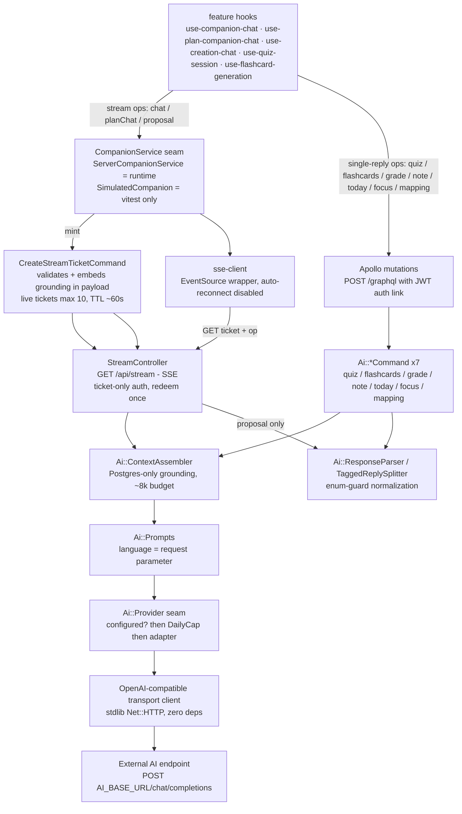
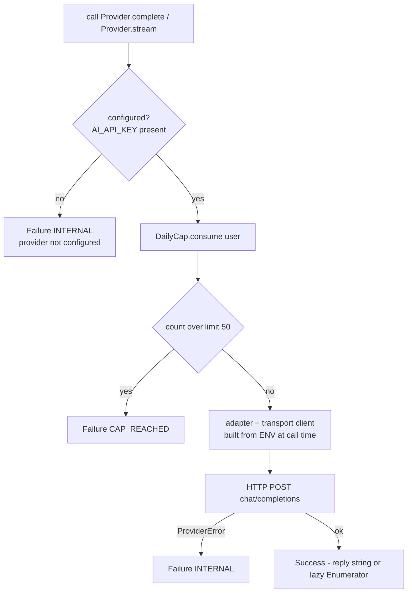

# AI call chain

How every AI behavior in Synapse travels from a React feature hook to the external
OpenAI-compatible endpoint and back. Reference doc for the spine's **AD-5** (response
contract produced server-side), **AD-12** (ENV-only config), **AD-16** (server-only AI,
one SSE surface, cap at the seam boundary), and **AD-18** (the frontend seam).

Last verified against code: 2026-11-07. File paths are repo-relative.

**The one-paragraph shape:** every AI operation crosses exactly one backend seam,
`Ai::Provider` (`backend/app/lib/ai/provider.rb`). Operations with a single JSON reply
ride GraphQL mutations (`POST /graphql`, JWT auth link); token-streamed operations ride
the ONE non-GraphQL surface, `GET /api/stream`, authenticated by single-use ~60s tickets
(browsers' EventSource cannot set headers). The seam resolves its config from ENV at
call time, enforces the per-user daily cap BEFORE any HTTP leaves the process, builds
the OpenAI-compatible transport client, and maps every transport fault into
`Failure(:INTERNAL)` — the command layer never sees an exception.

## Overview



## The seam — `Ai::Provider` dispatch order

The last stage of BOTH chains. `complete` resolves to a reply string, `stream` to a
lazy delta Enumerator (transport faults surface at pull time, where the SSE controller
turns them into a `terminal` event).



Config injection (AD-12, no settings gem): `AI_API_KEY` is the only required value
(blank = every AI surface answers INTERNAL); `AI_BASE_URL`, `AI_MODEL`,
`AI_TIMEOUT_SECONDS` are optional overrides of the built-in defaults. Locally the
values live in gitignored `backend/.env` (dotenv-rails, development only; compose-injected
ENV always wins; test never reads the file).

## Chain A — single-reply mutations (7 ops)

`generateQuiz` · `generateFlashcards` · `gradeOpenAnswer` · `generateNote` ·
`generateTodaySuggestion` · `generateStudyFocus` · `mapMaterialSections`

```mermaid
sequenceDiagram
    autonumber
    participant UI as feature hook or adapter
    participant GQ as POST /graphql
    participant C as Ai command
    participant CTX as ContextAssembler + Prompts
    participant PR as Ai Provider seam
    participant TR as transport client
    participant EX as external AI endpoint
    participant WR as write-path command

    UI->>GQ: mutation (generateQuiz / generateFlashcards / gradeOpenAnswer / ...)
    GQ->>C: dispatch
    C->>C: replay-before-spend — existing session uuid returns it, ZERO provider calls
    C->>C: scope xor, ownership, length bounds
    C->>CTX: assemble grounding (Postgres only) + build messages (language param)
    C->>PR: Provider.complete
    PR->>PR: configured? then DailyCap.consume then adapter
    PR->>TR: POST chat/completions (stream false)
    TR->>EX: HTTP
    EX-->>TR: assistant JSON text
    TR-->>C: raw reply
    C->>C: ResponseParser + enum-guard (drop unusable; zero usable = INTERNAL)
    C->>WR: persist through the only write path
    WR-->>UI: session / cards / grading over GraphQL
    Note over C,UI: failures ride the closed error enum -> AppError t() key -> toast
```

Mechanics worth knowing:

- **Replay-before-spend** (`GenerateQuizCommand`): the client-supplied session uuid is
  idempotent — a retry after a network timeout never spends a second cap call.
- **Enum-guard normalization**: individual unusable questions are DROPPED (a partially
  usable generation beats wasting the spent call); a reply with zero usable questions is
  a provider-contract violation → `INTERNAL`.
- **Only write paths persist**: AI output flows through the epic P2-3 commands (e.g.
  `Quiz::CreateSessionCommand`) and is validated like client input.
- **`gradeOpenAnswer` is the persistence exception**: pure computation, no rows — the
  outcome returns to the client and becomes evidence via the existing `recordEvidence`
  flow. Keywords and source text come from the question row, never the client.
- **Quiz scope xor is four-way**: `planId | taskId | targeting.nodeId | materialId` —
  the reader's Quick Test (material scope) additionally gates on ≥1 CONFIRMED
  section→node mapping before anything is spent, and attribution is decided
  server-side from the confirmed pairs (the model's own nodeId never decides).

## Chain B — token streams (3 ops, one SSE surface)

`companion` (material-grounded chat) · `plan_companion` (plan-grounded chat, FR-46) ·
`proposal` (plan-structure outline stream). Frozen event vocabulary:
`rung → token* → citation (companion only) → terminal{code}` (+`proposal` for the
proposal op).

```mermaid
sequenceDiagram
    autonumber
    participant UI as feature hook
    participant AD as ServerCompanionService
    participant SC as sse-client
    participant GQ as POST /graphql
    participant TC as CreateStreamTicketCommand
    participant CT as StreamController
    participant PR as Ai Provider seam
    participant TR as transport client
    participant EX as external AI endpoint

    UI->>AD: chat or planChat or generatePlanStructure
    AD->>GQ: mutation createStreamTicket (JWT)
    GQ->>TC: validate op, language, payload bounds
    TC->>TC: embed grounding inputs INSIDE the payload jsonb (query params are log-exposed)
    TC-->>AD: ticket token, TTL ~60s, live tickets max 10 per user
    AD->>SC: open stream
    SC->>CT: GET /api/stream (ticket + op)
    CT->>CT: StreamTicket.redeem — single-use; bad, expired, replayed, op-mismatch = 401 once, never retried
    CT-->>SC: event rung (server-derived: escalated = answer, else hint)
    CT->>PR: Provider.stream
    PR->>PR: configured? then DailyCap (cap refusal = terminal CAP_REACHED)
    PR->>TR: build client from ENV config
    TR->>EX: POST chat/completions (stream true)
    EX-->>TR: SSE deltas
    TR-->>PR: lazy Enumerator of deltas
    PR-->>CT: Success enumerator
    loop each delta
        CT-->>SC: event token
    end
    CT-->>SC: event citation (companion: server-built locator; plan_companion: only with a mistake entry)
    CT-->>SC: event terminal (code OK; proposal op carries the normalized proposal JSON)
    Note over SC,AD: drop = NO auto-reconnect — close, mint a FRESH ticket, restart the generation (cap-counted, deliberate double-count)
```

Mechanics worth knowing:

- **Ticket-only auth**: the grounding inputs (material/plan ids, question, ReadingPosition
  text, escalation flag, selection, language) ride INSIDE the ticket payload — one mint,
  one redeem, one generation. A client may hold at most 10 live tickets (`RATE_LIMITED`
  beyond, an anti-hoarding bound, since the cap counts redeems not mints).
- **Rung is always server-derived** — never trust a client-computed guardrail rung.
  `plan_companion` is always hint-first (its payload carries no escalation flag), so
  `canEscalate` is honestly false.
- **Citations are derived server-side** from the grounded position / the mistake entry's
  own source locator — never guessed client-side (AD-5).
- **Restart semantics**: EventSource auto-reconnect is never used. A drop closes the
  socket, mints a fresh ticket, and restarts the whole generation — deliberately counted
  against the daily cap. The server-side generation also keeps running (and billing)
  after a client disconnect. A client-side guard bounds a pathological drop loop.
- **The proposal stream** splits tags mid-flight (`Ai::TaggedReplySplitter`): `<outline>`
  content streams as tokens, `<proposal>` accumulates and is normalized at `finish`
  (epic-16 roadmap shape + legacy `nodeTitles` degradation), then rides `terminal`.
- **Chat persistence is decoupled**: thread messages persist through their own GraphQL
  mutation (`app/graphql/mutations/chat/append_message.rb`), never through the stream.

## Cross-cutting mechanisms

| Mechanism | Where | Contract |
| --- | --- | --- |
| Daily cap (FR-34) | `Ai::DailyCap`, enforced in the seam | 50 calls/user/day (AI_DAILY_CALL_CAP); stream restarts double-count by design; trips BEFORE any HTTP |
| Stream tickets | `StreamTicket` + `CreateStreamTicketCommand` | single-use, ~60s TTL (AI_STREAM_TICKET_TTL_SECONDS), payload-embedded grounding, ≤10 live per user |
| Replay-before-spend | `GenerateQuizCommand` | existing session uuid ⇒ return it, zero provider calls |
| Error closed enum | `error_presenter` ↔ `frontend/src/api/errors.ts` | enum mirrored 1:1; client maps codes to `t()` keys, never renders server strings |
| Reply sanitization | `frontend/src/ai/reply-sanitize.ts` | stream text passes sanitization before entering the UI |
| Frontend seam swap | `companion-service.ts` + `seam-preference.ts` | runtime = server adapter; vitest flips the whole suite to the simulated double; components never touch a provider API |

## e2e stub path

`just e2e` flips `AI_BASE_URL` at the compose layer to a local deterministic
double (`frontend/e2e/stub-provider.mjs`, an OpenAI-compatible `/chat/completions`
fake that pattern-matches the stable opening lines of the `Ai::Prompts` builders).
Production code is untouched — the stub is pure configuration, which is exactly the
AD-16 "provider swap is config, not code" property being exercised.

## File map

| Concern | File |
| --- | --- |
| Frontend seam + factory | `frontend/src/ai/companion-service.ts` |
| Runtime adapter | `frontend/src/ai/companion-service-server.ts` |
| SSE client (mint + open + restart) | `frontend/src/ai/sse-client.ts` |
| Error enum mirror | `frontend/src/api/errors.ts` |
| The ONE SSE endpoint | `backend/app/controllers/api/stream_controller.rb` |
| Ticket minting | `backend/app/commands/ai/create_stream_ticket_command.rb` |
| Generation commands (7 ops) | `backend/app/commands/ai/*.rb` |
| Provider seam (config, cap, error mapping) | `backend/app/lib/ai/provider.rb` |
| Transport client (instantiated by the seam) | see `Ai::Provider.adapter` |
| Grounding assembly | `backend/app/lib/ai/context_assembler.rb` |
| Prompt builders | `backend/app/lib/ai/prompts.rb` |
| Reply parsing / tag splitting | `backend/app/lib/ai/response_parser.rb`, `backend/app/lib/ai/tagged_reply_splitter.rb` |
| Daily cap | `backend/app/lib/ai/daily_cap.rb` |
| Frozen wire specs | `backend/spec/requests/api_stream_spec.rb`, `backend/spec/ai/*` |
