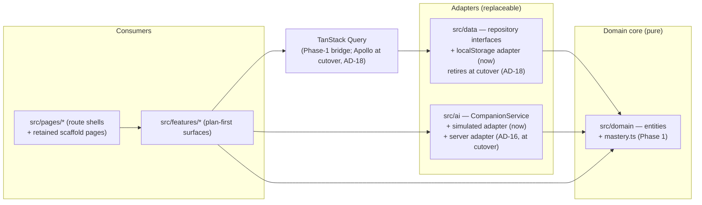
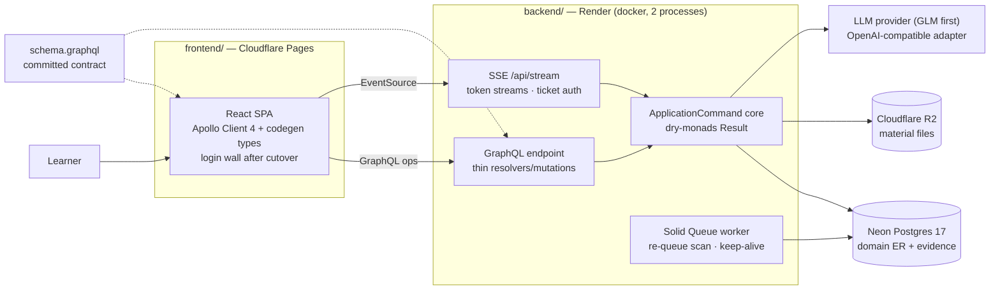
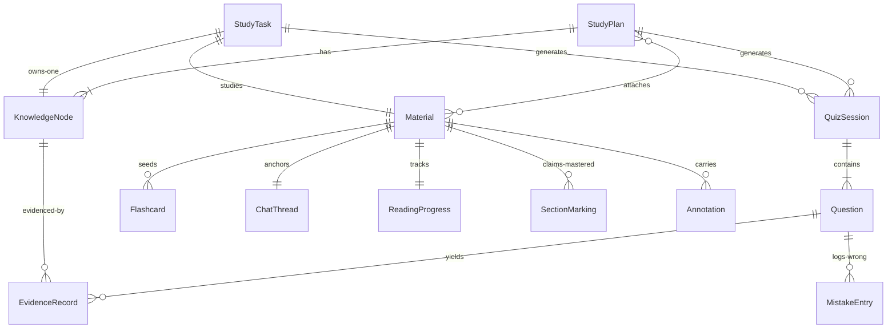
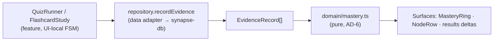

# Architecture Spine — Synapse · Static-First Frontend + Rails GraphQL Backend

**FR-29\*:** persistence binds as relaxed by owner decision 2026-11-02 — everything persists as localStorage JSON **except Material file blobs**, which are session-only (re-upload after reload). See AD-4.

**FR-33\*:** server-side AI binds as **deferred to Phase 2** by owner decision 2026-11-03 — Phase 1 ships the simulated adapter (AD-5) and the Nov-6 demo runs without a server; the server lands at the cutover (AD-16). This supersedes the PRD's `[Phase 1]` tag, which predates the static-first decision.

**Scope line (owner, 2026-11-02; extended 2026-11-03):** Phase 1 = the static build — full interactive frontend, simulated AI behind an adapter, local persistence; ships 2026-11-06 unchanged. The 2026-11-03 update adds the **Phase-2 architecture**: a Rails GraphQL backend modeled on qc-center-api's conventions and the monorepo shape — **design now, implementation post-Nov-6** (Phase-2 epic-0 restructures the repo). FR-33 stays deferred for the Nov-6 demo. **Owner amendment, 2026-11-03 (later same day):** epic-0 was implemented early at owner direction — shipped on branch `epic/p2-0-monorepo` (two-axis review clean, CI green) and merged to `main`. The owner has **not** configured Cloudflare Pages yet, so the "configure Pages this week against the old layout / re-point after merge" sequencing (Q3=b) is void — Pages is configured **fresh against the monorepo layout** (root directory `frontend` — folder renamed from `web` 2026-11-04, see the AD-17 naming note) whenever the owner deploys; no re-point step exists.

**The cutover** — the single Phase-2 event where the backend turns on: the web app moves behind a login wall, local adapters retire, the server becomes authoritative. AD-1..11 bind everything **before** it (they ship Nov 6); AD-12..20 bind everything **after**. Cross-notes on the retired ADs mark the seam; IDs never renumber.

## Design Paradigm

**Ports-and-adapters in the small** (frontend) **+ a command-core Rails GraphQL API behind those same seams** (backend). A pure TypeScript **domain core** (entity types + logic) sits at the center; **feature modules** render it; exactly two **adapter seams** — `data` (persistence) and `ai` (Companion) — own all external effects. The static build's "backend" is the local adapter pair; the Rails API is the adapter **replacement** those seams were built for, not a refactor.



**Phase-2 system shape (post-cutover):**



## Invariants & Rules

### AD-1 — One paradigm: domain core + two seams

- **Binds:** all frontend units
- **Prevents:** half the surfaces reading a shared store and half inventing local shapes — the divergence that made the old scaffold's 13 pages unaggregatable (hubs FR-23/27/41/42 need one data shape)
- **Rule:** all domain data flows `features → (query) → data adapters`; all AI flows `features → ai adapter`. No third side-channel. The paradigm carries: when a new capability needs an external effect, it gets an adapter, not a fetch call in a component. At cutover the seams diverge **asymmetrically** (AD-18): the **data seam retires** — Apollo's normalized cache becomes the single owner and features consume codegen typed hooks directly; the **ai seam survives** — a server-backed CompanionService swaps in behind the unchanged interface (AD-16), and features never call AI operations via raw Apollo hooks.

### AD-2 — Module boundaries & dependency direction

- **Binds:** `src/*` structure, all new code
- **Prevents:** cross-feature imports creating hidden coupling two builders can't see
- **Rule:** `pages → features → {domain, data, ai, components/ui, components/shared, contexts}`; `domain` imports nothing app-specific (pure TS, no React); `data → domain`; `ai → domain`; `components/shared → ui + lib + the LanguageProvider` (`t()` only). Features never import each other's **internals** — a feature may expose a named public surface (the reader's `parse(file)` API, the companion's exported `CompanionPanel`); imports beyond it are forbidden. Shared UI goes to `components/shared`, shared data through `data`, shared types through `domain`. `ReadingPosition` — locator (PDF page number | Markdown section id) + its extracted text — is a **domain type**: persisted progress, the reader's tracker, and CompanionService's grounding input all consume it verbatim; features never redefine it. Retained scaffold pages are **grandfathered** inside `pages/` as-is; each migrates into a feature module only when its FR re-points it (FR-25/26/28/36), never in a big-bang refactor. After the epic-0 restructure all paths gain the `frontend/` prefix (AD-17; the folders were renamed `web/`+`api/` → `frontend/`+`backend/` on 2026-11-04 at owner direction — shape and rules unchanged).

### AD-3 — Data ownership: repositories + Query, no domain contexts

- **Binds:** all domain entities and their mutation paths
- **Prevents:** two ownership systems (context setState vs. repository) racing for the same entity
- **Rule:** repository interfaces in `src/data` are the single owner of domain entities (StudyPlan, KnowledgeNode, Material, StudyTask, QuizSession, Question, EvidenceRecord, Flashcard, MistakeEntry, ReadingProgress, ChatThread). Features read/write only via repositories, consumed through TanStack Query (`useQuery`/`useMutation` + invalidation). **No new React contexts for domain data** — contexts are reserved for cross-cutting UI concerns (language). `UserProgressContext` is frozen as retained demo garnish; new plan-first surfaces never write to it; it retires as plan evidence re-points the retained pages. **Cutover:** the Query bridge and repository seam are replaced by Apollo Client (AD-18) — Phase-1 truth, retired with the static build.

### AD-4 — Local store: one versioned localStorage document

- **Binds:** FR-29 (as relaxed), all persisted data
- **Prevents:** per-feature localStorage keys with clashing shapes and no migration path
- **Rule:** a single key `synapse-db:v1` holds one JSON document with a schema `version` field; the local adapter owns full-document synchronous writes and migrations. localStorage's other role stays exactly as-is: `synapse-lang` (UI pref). **Material file blobs are the only session-only data** (owner decision 2026-11-02) — a reload re-uploads; metadata, extracted page/section text + parse state (bounded per-section size, so one document cannot blow the ~5MB quota), evidence, chat, reading positions, and the onboarding-complete flag persist. Revisit: if reload pain shows in real use, add an IndexedDB blob adapter inside `data/` — features untouched. **Cutover:** runtime persistence moves to Postgres (AD-13); a one-time import reads this document (AD-15); UI-pref keys (`synapse-lang`, theme) outlive the cutover.

### AD-5 — AI seam: CompanionService now, FR-33 later

- **Binds:** FR-11, FR-12, FR-18, FR-19, FR-33
- **Prevents:** components coupling to a provider API (or to fake `setTimeout`s) that the server integration must then hunt down
- **Rule:** `src/ai` defines `CompanionService` — chat grounded on a Reading Position, **plan-structure generation** (topic/goal → staged node proposal for the creation chat, streamed like chat), quiz generation by mode from material refs (**questions return node-attributed**, AD-6), flashcard generation, open-answer grading with rationale — and ships a **deterministic simulated implementation** (keyword-routed, artificial delay, streamed emission) for the static build. The server-side implementation (FR-33, AD-16) replaces it behind the same interface. The plan-creation transcript is ephemeral until the plan is confirmed (a ChatThread anchors to a Material; none exists yet). Guardrail posture (NFR-2) is carried by the structured response contract (intent, rung, citations) per EXPERIENCE.md — the UI renders the contract, never guesses it. No component performs AI/network calls directly. **Cutover:** the simulated adapter leaves the runtime path and survives as the dev/test double (AD-18).

### AD-6 — Mastery Score is one pure function

- **Binds:** FR-3, FR-20-frontend, SM-3, SM-C2
- **Prevents:** Plan Home, Task home, Dashboard, and Analytics each computing rollups differently — the number stops meaning one thing
- **Rule:** `domain/mastery.ts` holds the single implementation: EvidenceRecords → per-Knowledge-Node score (uncovered / partial / mastered vocabulary per EXPERIENCE.md) → plan rollup, where **rollup reaches 100% only when every node is mastered**. Every generated Question carries **node attribution at generation time** — `EvidenceRecord.nodeId` is required in Phase 1 (a whole-plan quiz attributes coarsely via the plan's node list; Phase 2 defers node-*targeted* generation, never attribution). Every Study Task owns exactly one auto-created KnowledgeNode (`taskId` set, `planId` null); plan rollups and plan-node listings select by `planId`, and the task rollup reads its single node — no other rollup exists. `domain/` owns **all** evidence-derived rollups — mastery, and the FR-25 streak's consecutive-evidence-days (SM-C3) — under this same rule; no surface computes its own. Weighting, partial credit, and decay values live in ADR-0001 (last-5 windowed mean; mastered ≥80 & ≥3; <3 evidence caps node score at 99; rollup = mean-of-scores). **Cutover:** the single implementation moves to Ruby server-side; the TS version retires with the static build (AD-14).

### AD-7 — Client-side document rendering

- **Binds:** FR-8, FR-9, FR-10
- **Prevents:** reader implementations drifting on engine choice; resolves OQ-5 for this scope
- **Rule:** PDF: **pdfjs-dist 6.x** — page-by-page rendering plus per-page text extraction (the Reading Position's content). Markdown: **react-markdown 10.x + rehype-slug 6.x** — hierarchical headings with stable section IDs. Both live inside the reader feature, which exposes a public `parse(file) → { sections, text, state }` extraction API (progress, failure, retry) callable from plan/task upload flows; pdfjs-dist is dynamically imported only there (AD-8). **Client-side parsing is retained through the cutover** — the server persists what the client extracted (AD-13); server-side parsing stays deferred.

### AD-8 — Routing: front door at `/`, sessions are routes

- **Binds:** FR-1, FR-36, FR-37, UX IA table
- **Prevents:** quiz/flashcard sessions built as unaddressable modal stacks; landing-page ambiguity
- **Rule:** react-router 6 (inherited). `/` renders Onboarding on first run, then **Plans Home** — the front door; `/plans` addresses the same surface. The onboarding-complete flag is a field of the `synapse-db` document (AD-4); when FR-1 lands, Onboarding's ready step — and any scaffold "home" redirect — navigates to `/`. Plan-first routes: `/plan/new`, `/plan/:id`, `/task/new`, `/task/:id`, `/read/:materialId`. In-flow quiz and flashcard sessions are focused **sub-routes** (`/plan/:id/quiz`, `/task/:id/quiz`, `/plan/:id/flashcards`, …), never modals. The reader route accepts position anchors (`?page=N` / `#section-id`, plus a transient highlight flag) — the **only** cross-feature command channel into the reader (CitationChip clicks, continue cards). Retained scaffold routes unchanged until their FR re-points them. **pdfjs-dist is dynamically imported only inside the reader feature** — no other module imports it directly. **Cutover adds exactly one route:** the login wall (AD-15); all addressing above survives unchanged.

### AD-9 — Scaffold conventions bind new surfaces [ADOPTED]

- **Binds:** all UI code
- **Prevents:** new surfaces restyling around raw palette classes or hardcoded strings
- **Rule:** i18n via the `translations` table + `t()` with zh+en parity (NFR-5) — never hardcoded strings; semantic Tailwind tokens + shadcn/ui primitives; `cn()` for conditional classes; TypeScript stays loose (not tightened); **sonner** is the single toast pattern; the EXPERIENCE.md **Accessibility Floor binds all new surfaces** (WCAG 2.2 AA, keyboard-complete quiz, never-color-only study states, reduced-motion collapse). Domain entities are **language-neutral**; the bilingual `Record<zh,en>` demo-data pattern stays a retained-page pattern only. **The api is not user-facing** — its strings are error codes and log lines (English), never rendered verbatim; the web app maps codes to `t()` keys.

### AD-10 — Testing posture

- **Binds:** domain + dense-behavior features; post-cutover, the api
- **Prevents:** the one algorithm the product promises (mastery) shipping unverified
- **Rule:** vitest unit tests are mandatory for `domain/` (mastery first: uncovered-never-green, rollup cap, evidence-only movement) and for dense behavior (quiz attempt gate, reading-position tracking). Gates: `npx tsc -b` + `npm run lint` + `npm run test`. **Api:** RSpec + factory_bot, specs colocated; commands and GraphQL operations tested directly (the reference pattern); mastery port carries **golden vectors generated from the TS suite** (AD-14). E2e deferred (Playwright config dep absent — open item).

### AD-11 — Deployment: static SPA host (Phase 1)

- **Binds:** FR-35, NFR-6
- **Prevents:** deploy-time surprises from client-side routing or env assumptions
- **Rule:** `vite build` produces a static bundle; deploy to a static host with **SPA-fallback rewrite to `index.html`** and auto-deploy from `main`. No env vars, no server, no warm-up (NFR-6). **Vendor decided 2026-11-03: Cloudflare Pages** — `_redirects` SPA fallback; the full Phase-2 envelope is AD-20.

**Phase-2 ADs (2026-11-03 update — backend + monorepo; implementation post-Nov-6 — **amended same-day at owner direction: epic-0 landed early, see the scope-line amendment**; qc-center-api conventions adopted per the adopt/skip list in the memlog):**

### AD-12 — One Rails API: GraphQL-first, command-core

- **Binds:** all `backend/` units; the frontend↔backend contract
- **Prevents:** fat resolvers and a second service-object style drifting from the reference conventions; REST/GraphQL double surfaces
- **Rule:** a single **Rails 8.1.x API-only** service (puma; graphql-ruby 2.5.x; depth/complexity limits + Dataloader batching on). Every use case is an **`ApplicationCommand`** class (dry-initializer + dry-monads `Result`): resolvers/mutations parse args → authorize → call the command → map the Result; jobs are thin wrappers that load a record and call a command; **business logic never raises** — failures are `Failure` values. **Error contract:** GraphQL error `extensions.code` is a **closed enum** — `UNAUTHORIZED | FORBIDDEN | NOT_FOUND | VALIDATION_FAILED | RATE_LIMITED | CAP_REACHED | INTERNAL` — defined in `backend/`, mirrored as `AppError.code` in the frontend, mapping 1:1; adding a code touches both sides in the same change (the frontend maps codes to `t()` keys, never renders server strings — AD-9). **Ids are plain UUID strings** (no GlobalID), globally unique (uuid primary keys); clients may supply ids on create — the first-login import is thereby idempotent (AD-15). Pagination: plain lists until a list actually paginates (evidence history is the first candidate for Relay connections). The SSE endpoint (AD-16) is the **only** non-GraphQL api surface — presigned R2 upload/download URLs (AD-13) point at R2, not the api. **Not adopted from the reference:** settings gem (ENV only), Sidekiq/Redis (AD-19), OTel/Sentry/Yabeda, SCIM, multi-tenancy (single product; per-user scoping suffices — AD-13).

### AD-13 — Server data model: the spine ER, user-scoped

- **Binds:** api models + migrations; FR-4, NFR-3/7
- **Prevents:** a second entity vocabulary; cross-user leakage
- **Rule:** ActiveRecord entities are the ER below — entity ownership moves from `src/data` to `backend/app/models` at cutover, one model per entity, no renames. Every user-owned row is scoped by `user_id`, enforced in the command layer and asserted by a shared RSpec context (one authenticated user cannot list or fetch another's data by id — FR-4's testable consequence). The **single sanctioned exception**: the Square's public-plan read path (FR-38/39) — **structure only**, never Materials/Annotations/Mastery Scores (NFR-7); adoption = fork with attribution (OQ-12). Postgres 17 everywhere: **Neon in production, the same major version in the dev compose** (local/prod parity). `strong_migrations` on; plain schema migrations (no data-migration split, no logidze, no soft delete). **Material files** go to object storage via ActiveStorage → **Cloudflare R2** (Render disk is ephemeral); original file to R2, extracted sections/text to Postgres; parsing stays client-side (AD-7). Uploads presign via a GraphQL mutation (`createMaterialUpload` → R2 presigned PUT; the browser PUTs directly to R2, which carries its own CORS allowlist for the frontend origin — the ActiveStorage REST direct-uploads route is never mounted); downloads use short-lived presigned GET URLs exposed as GraphQL fields. The dev compose runs a **minio** service as the R2 stand-in (same S3 API).

### AD-14 — Mastery computation moves home at cutover

- **Binds:** FR-3, FR-20, SM-3/SM-C2; amends AD-6 for Phase 2
- **Prevents:** two live mastery implementations drifting — the number stops meaning one thing (the divergence AD-6 exists to prevent)
- **Rule:** at cutover the **single implementation becomes Ruby in `backend/`** — ADR-0001 rules verbatim (last-5 windowed mean; mastered ≥80 & ≥3; <3 evidence caps at 99; rollup = mean-of-scores, 100% only when every node is mastered); the TS version retires with the static build. The port is verified by **golden vectors generated from the TS test suite** (same inputs → same scores, both directions of every boundary): committed JSON fixtures — decimals as strings, exact-equality comparison, timezone-tagged timestamps with the streak's day-boundary policy stated, rounding mode + operation order pinned in ADR-0001's terms — generated by a TS script in the frontend (runs until cutover), consumed by RSpec from `backend/spec/fixtures/`. The client renders server-computed scores; it never recomputes. Streak and all other evidence-derived rollups move with it.

### AD-15 — Accounts: email+password JWT; the anonymous era ends

- **Binds:** FR-30, FR-31, FR-4; supersedes AD-4's runtime posture at cutover
- **Prevents:** a permanently maintained offline parallel path; auth-scheme drift (cookies vs tokens across origins)
- **Rule:** FR-30 via **email + password (bcrypt) + JWT bearer** in the Authorization header — chosen over cookies because web (Cloudflare) and api (Render) are cross-origin; Google OAuth is deferred (FR-30 allows either). Token policy: stateless JWT, ~24h TTL, no refresh machinery v1; logout = discard token + reset the client cache + terminate live SSE (AD-18); no revocation/denylist (accepted risk for the course timeline); login attempts rate-limited; password reset deferred (no SMTP on free-tier Render — Deferred). **Cutover = login wall**: the anonymous/localStorage mode retires from the runtime; NFR-6 survives via a **seeded demo account** and the pre-login surface staying fully static on Cloudflare. **First login offers a one-time import** of `synapse-db:v1` — whole-document upload as **one transaction, one idempotent mutation** (client-supplied UUIDs, AD-12); on id conflict the command upserts with **ownership verification**: an id already owned by a different user is `VALIDATION_FAILED` (never a silent link to another user's rows — FR-4), same-user conflicts are skipped, so retry is safe. The document by AD-4 never contained file bytes: the import flow invites **re-attaching original files** (client re-upload per AD-13, matched by id); PDFs not re-attached render text-only thereafter. GraphQL context carries `current_user` from the JWT; every command receives it (AD-13 scoping).

### AD-16 — AI executes server-side only; one SSE surface for streams

- **Binds:** FR-33, FR-34, NFR-4; resolves OQ-4's direction
- **Prevents:** provider keys on the client; streaming hacked through GraphQL; uncapped spend
- **Rule:** provider keys live only in backend config (ENV + `.env.example`, reference pattern). The provider sits behind an **OpenAI-compatible adapter** — **GLM first**, terms verified before build (OQ-4); a provider swap is config, not code. All AI operations are GraphQL mutations (quiz/flashcard generation, grading, plan proposals) **except token streams** (Companion chat, plan-creation chat): one Rails **SSE endpoint** (`/api/stream`) emits them. **Ticket contract:** an opaque single-use secret, TTL ~60s, minted by a `createStreamTicket` mutation, bound to `current_user` + the pending operation, carried as a query param (log exposure accepted); the endpoint never retries auth (401 on a bad ticket) and sits under the same CORS origin allowlist as GraphQL. The client wraps EventSource with auto-reconnect **disabled** — on drop it mints a fresh ticket and **restarts** the generation (deliberately counted against the cap; no server-side resume buffering v1). **Event vocabulary:** token, citation, rung, and terminal events carrying an error `code` — the AD-5 response contract (intent, rung, citations) is produced server-side and rides the stream, and the **reply language (zh/en) is a request parameter** following the UI toggle (EXPERIENCE). **Cost cap (FR-34, value set here per NFR-4): 50 AI calls/user/day + ~8k-token context-in bound per request**, enforced at the AI adapter boundary, values in server config. Generation is in-request (streamed) — no AI jobs.

### AD-17 — Monorepo: two apps, one contract, one entrypoint

- **Binds:** repo top level, CI, all tooling
- **Prevents:** scattered per-app task runners; a "shared package" that couples the two stacks
- **Rule:** the repo root becomes **`frontend/` + `backend/` + `justfile`** (docs/.scratch stay put) — no `apps/` nesting, **no shared code package**: the only cross-stack contract is **backend-committed `schema.graphql`**, consumed by frontend's `graphql-codegen` (`npm run codegen` — the frontend stays on its incumbent toolchain; the reference's pnpm script is not adopted). A root **justfile** orchestrates both (`just setup/dev/up/spec`); backend's dev containers run via `backend/.dockerdev/compose.yaml` (postgres + backend) per qc-center-api's just+compose DX. The restructure is **Phase-2 epic-0**: a mechanical move of the Vite app into `frontend/` (paths gain the `frontend/` prefix, AD-2 note), root AGENTS.md + a new **`backend/AGENTS.md`** (the backend's architecture contract, the reference's pattern) + CI updated in the same change; CI = existing frontend gates + backend `rubocop`/`rspec`. **Naming (owner decision, 2026-11-04):** the folders were renamed `web/`+`api/` → `frontend/`+`backend/` after epic-0 merged (CI green, gates unmodified); this AD's shape is unchanged, and pre-rename prose/tracker text saying "web"/"api" refers to these folders under their old names.

### AD-18 — Web client swap: Apollo Client at cutover

- **Binds:** post-cutover web data layer; supersedes AD-3's bridge
- **Prevents:** two client caches fighting; the retired static architecture leaking into Phase 2
- **Rule:** at cutover, **Apollo Client 4.x + graphql-codegen typed hooks** replaces TanStack Query and the repository layer; Apollo's normalized cache becomes the single client-side owner of domain data (contexts stay UI-only; `UserProgressContext` retires with the static build). The **simulated CompanionService survives as a dev/test double only** — deterministic tests keep running without a server. UI prefs (`synapse-lang`, theme keys) keep their localStorage roles. Any auth change (login/logout/account switch) **resets the Apollo cache and terminates live SSE connections** — user A's normalized data never surfaces for user B (FR-4). Owner decision 2026-11-03: the anonymous mode's retirement is what makes Apollo coherent (no local-mode ApolloLink shim needed).

### AD-19 — Jobs: Solid Queue, DB-backed, no Redis

- **Binds:** background + scheduled work in api
- **Prevents:** a Redis/Sidekiq dependency for a job volume of ~zero; a paid second Render service for a worker with ~nothing to do
- **Rule:** **Solid Queue** (Rails 8 built-in, DB-backed on the same Postgres) runs **in-process with puma** — no separate worker service (Render has no free worker instance type, and the queue's volume does not earn a paid one). It connects via Neon's **direct (non-pooled) connection URL** (its polling dislikes transaction-mode pooling). Recurring v1: the **FR-24 re-queue due scan** — correct-on-wake: due-ness is recomputed from timestamps when the service wakes, not accumulated while asleep. **No keep-alive loop** — a self-hosted ping is circular (it sleeps with the service), and keeping the service awake makes the queue's polling keep Neon awake, exhausting its ~191 free compute-hours in ~8 days; cold starts are accepted per AD-20. No new background work without a named need (none identified: AI is in-request streaming, parsing is client-side).

### AD-20 — Deployment envelope: Cloudflare Pages · Render · Neon · R2

- **Binds:** FR-35, NFR-6, all environments; fixes AD-11's deferred vendor
- **Prevents:** environment drift between local and production; cold-start demo embarrassment
- **Rule:** **web → Cloudflare Pages** (SPA fallback via `_redirects`, auto-deploy from main). **api → Render** docker service (single web process; Solid Queue in-process — AD-19). **DB → Neon Postgres 17**; **blobs → R2** (AD-13). CORS allows only the web origin (GraphQL + the SSE route). Local dev = `just up` (compose postgres + api + Vite + minio) — same shape as production. **Free tier, no keep-alive**: idle spin-down is accepted (~1 min cold start: Render wake + Neon autosuspend resume) outside graded windows; **before a graded demo, upgrade Render + Neon for the demo window** (wake the stack once pre-demo). NFR-6 holds because everything before the login wall is static on Cloudflare and the demo account is pre-seeded. **Cutover rollback** = redeploy the last pre-cutover commit on Cloudflare Pages; the anonymous static build resumes from the still-present `synapse-db:v1` (import never deletes it); server-side work after cutover is abandoned, not merged back.

## Consistency Conventions

| Concern | Convention |
| --- | --- |
| Naming | Entities/files PascalCase types, camelCase fields; feature dirs kebab or singular-noun (`features/plans`, `features/reader`); query hooks `use<Entity>Queries` inside `data/` (Phase 1); api commands `Context::VerbNounCommand` |
| Data & formats | ids = UUID strings (`crypto.randomUUID()` client-side; uuid columns server-side, client-suppliable on create); dates = ISO 8601 strings; store = single `synapse-db:v1` document with `version` field (Phase 1) |
| State & mutation | Phase 1: domain data only via Query + repositories; UI-local state stays in components; mutations invalidate affected query keys. Post-cutover: Apollo cache owns domain data; same "no domain contexts" rule |
| Errors | Phase 1: adapters throw typed `AppError { code, messageKey? }` → sonner toasts. Post-cutover: GraphQL `extensions.code` = `AppError.code` 1:1 (AD-12); SSE terminal event `{ code }`; web maps codes to `t()` keys — never silent, never fake success |
| Config | Phase 1: none (simulated AI is code). api: ENV + `.env.example` (DATABASE_URL, JWT_SECRET, PROVIDER_KEY, R2_*, CORS_ORIGIN, cap values — AD-16/20) |

## Stack

| Name | Version |
| --- | --- |
| TypeScript (loose config, per AGENTS.md) | ^5.8.3 |
| React | ^18.3.1 |
| Vite | ^5.4.19 |
| react-router-dom | ^6.30.1 |
| @tanstack/react-query (Phase 1 only) | ^5.83.0 |
| shadcn/ui (Radix) + Tailwind CSS-variable tokens | 46 primitives · tailwind ^3.4.17 |
| framer-motion / recharts / sonner | ^11 / ^2.15.4 / ^1.7.4 |
| **pdfjs-dist** (new — reader) | 6.x |
| **react-markdown + rehype-slug** (new — reader) | 10.x · 6.x |
| vitest + Testing Library | ^3.2.4 · ^16 |

**Phase-2 additions (backend + cutover; exact pins at scaffold):**

| Name | Version |
| --- | --- |
| Ruby / **Rails (API-only)** | scaffold pin / **8.1.x** (≥ 8.1.4, verified 2026-11-03) |
| puma · graphql-ruby | 7.x · 2.5.x |
| **Solid Queue** (Rails 8 built-in) · pg | with Rails · Postgres 17 |
| bcrypt · jwt · dry-initializer · dry-monads | current stable at scaffold |
| strong_migrations · rspec-rails · factory_bot_rails · rubocop | current stable at scaffold |
| aws-sdk-s3 (ActiveStorage → R2) | current stable at scaffold |
| **@apollo/client** (web, at cutover) · graphql-codegen | **4.x** (verified 2026-11-03) · current |

## Structural Seed

Target shape after the Phase-2 epic-0 restructure (landed 2026-11-03 — this shape IS the repo; AD-2 paths are `frontend/`-prefixed):

```text
/                      # repo root
  justfile             # setup · dev · up · spec — orchestrates web + api
  frontend/                 # the Vite SPA, moved wholesale (AD-17)
    src/               # domain/ data/ ai/ features/ pages/ components/ contexts/ lib/ (AD-2)
    codegen.ts         # graphql-codegen (npm run codegen) ← ../backend/schema.graphql (AD-17/18)
  backend/                 # Rails 8.1 API-only (new, AD-12)
    app/
      graphql/         # types/ mutations/ resolvers/ — thin (AD-12)
      commands/        # ApplicationCommand + use cases — the core
      models/          # the ER below, user-scoped (AD-13)
      controllers/     # graphql#execute + the SSE stream only
      jobs/            # Solid Queue (AD-19)
    config/ db/ spec/  # ENV+.env.example · migrations · colocated RSpec
    .dockerdev/        # compose: postgres + api (dev, AD-17)
    schema.graphql     # THE cross-stack contract (committed)
    AGENTS.md          # the api's architecture contract (AD-17)
  docs/ .scratch/      # as-is
```

**Core entities (names + ownership only; fields refine at spec time — Phase-1 owner `data/` (AD-3), post-cutover owner `backend/app/models` (AD-13)). The list is the Phase-1 core, not closed: Phase-2 features add entities at spec time (e.g. `Annotation` for FR-16/17, StudyPlan's FR-38 visibility field):**



**Evidence loop (the product's core data flow; Phase-1 shape):**



**Post-cutover the loop's middle moves server-side (AD-14/16):** `mutation → command → Postgres`; mastery runs in Ruby; the client renders server scores through Apollo.

## Capability → Architecture Map

| Capability / Area | Lives in | Governed by |
| --- | --- | --- |
| FR-1 entry states, Plans Home | `features/plans` + `/` route + `src/ai` plan generation | AD-8, AD-2, AD-5 |
| FR-2 material attach (UploadDropzone) | `features/plans` + `data` Material repo + reader `parse(file)` API | AD-3, AD-7 |
| FR-3 Mastery Score | `domain/mastery.ts` → Ruby at cutover | AD-6, AD-14 |
| FR-4 plan privacy | api command-layer scoping + RSpec context | AD-13 |
| FR-8/9/10 reader + Reading Position | `features/reader` | AD-7, AD-8 |
| FR-11/12 Companion chat + guardrails | `features/companion` + `src/ai` → SSE + GraphQL | AD-5, AD-16 |
| FR-18/19 quiz + flashcard generation | `features/quiz`, `features/flashcards` + `src/ai` | AD-5, AD-8, AD-16 |
| FR-24 re-queue (Phase 2) | api Solid Queue recurring | AD-19 |
| FR-25 plan home (light) + streak | `features/plans` + `domain` streak rollup (→ server, AD-14) | AD-2, AD-6 |
| FR-29 persistence | `data` local adapter → Postgres at cutover | AD-4, AD-13, AD-15 |
| FR-30/31 accounts + sync | api identity (bcrypt + JWT) + first-login import | AD-15 |
| FR-32 bilingual UI | `contexts/LanguageProvider` + `t()` | AD-9 |
| FR-33 server-side AI | api AI adapter + SSE endpoint | AD-16 |
| FR-34 cost cap | api adapter-boundary counter (50/day + context bound) | AD-16 |
| FR-35 deployment | CF Pages + Render + Neon + R2 | AD-11, AD-20 |
| FR-36 IA / sidebar ordering | routes + `AppLayout` | AD-8 |
| FR-37 Study Task | `features/tasks` | AD-2, AD-8 |
| FR-13/14/15 (stretch) | `features/reader` selection bar / marking | AD-7; detail at spec |
| Square (FR-38/39, Phase 2) | api public-plan read path — the one AD-13 scoping exception, structure-only (NFR-7); adoption = fork w/ attribution (OQ-12) | AD-13 |
| FR-46 plan-level Companion + FR-44/45 node-scoped grounding, section→node mapping | api AI adapter context assembly (plan scope, no Reading Position) + SSE stream | AD-16, AD-5 |
| Monorepo restructure | Phase-2 epic-0 (mechanical move + CI + AGENTS.md ×2) — **done 2026-11-03** (branch `epic/p2-0-monorepo`, merged to `main`) | AD-17 |

## Deferred

| Decision | Revisit when |
| --- | --- |
| Google OAuth (FR-30's second half) | a real user asks for it — email+password ships first |
| ActionCable / GraphQL subscriptions | a feature needs server→client push (SSE covers streams) |
| Relay connections pagination | the first list that actually paginates (evidence history) |
| AI provider terms verification + swap (OQ-4 residual) | backend build starts (GLM first, adapter makes swap config) |
| Server-side PDF parsing (OQ-5 residual) | client-side parsing hurts on real devices (AD-7 retains it) |
| packwerk-style boundary enforcement in api | api grows past ~10 domains (dirs + review suffice below that) |
| Node-*targeted* quiz generation (FR-21 mechanism; not attribution) | Phase 2 per AD-6 |
| Roadmap renderer, graph vs custom SVG (OQ-2) — **resolved, then amended (epic-16, 2026-11-06)**: the FR-5 build kept **custom SVG, zero dependencies** (epic-10's kickoff delta decision 1 — NFR-6 bundle discipline + the AD-9 keyboard path; original criteria trail in [.scratch/phase-2/epic-10-nodes/epic.md](../../../.scratch/phase-2/epic-10-nodes/epic.md) "Kickoff delta review" item 1). Epic-16 **amended the structure, not the stack**: stage columns + derived-order pseudo-edges → deterministic swimlanes + persisted prerequisite edges + orthogonal elbow routing (legacy zero-edge plans keep the derived-sequence fallback, selected per-plan by edge presence; amendment trail in the [epic-16 kickoff delta review](../../../.scratch/phase-3/epic-16-interactive-roadmap/epic.md) item 1). The roadmap.sh posture is **clean-room honesty** (grill decision 8): structural/behavioral vocabulary only — rounded nodes, swimlane tints, dashed optional markers, orthogonal arrows — mapped to the app's semantic tokens; no colors, text, layout data, or content copied | — (row consumed; remaining roadmap gaps live in the three rows below) |
| Roadmap editor (drag-to-reposition, manual connect/disconnect) | positions would need persistence first (epic-16 delta 5 deliberately ships none — layout is a pure function); a separate epic if ever wanted |
| Back-jump (later→earlier stage) edges, per-edge labels, edge weights | learning-order semantics ever need them — today stage-backward pairs drop at confirm (epic-16 delta 4: soft stage-forward learning order, cycles impossible by construction) |
| Touch pinch-zoom on the roadmap canvas | the broader touch-interaction batch (pointer-drag pan + wheel/buttons zoom ship today; pinch deferred with it, epic-16 out-of-scope) |
| FR-43 roadmap.sh import — **dropped by owner decision 2026-11-06** (wontfix): the content license forbids republishing outside the repository and the owner declines to seek consent (ruling + decision in epic-11 ticket 04). Linking out to roadmap.sh stays allowed; a build revives only if the license changes or the owner later obtains written consent | license change, or the owner obtains prior written consent from the roadmap.sh author |
| FR-15 web Mastery-Marking UI — **SHIPPED 2026-11-06** (epic-15, night run: the §6.2 diff-check unlock fired; placement taken under the standing decide-all delegation = reader section-level; read query + web seam + reader UI + confirm-quiz launcher; live smoke claim→persist→unmark PASS; see [.scratch/phase-2/epic-15-marking-ui/](../../../.scratch/phase-2/epic-15-marking-ui/epic.md)) | — (row closed; the trigger fired and the ticket consumed the live ops) |
| Materials hub server backing — **SHIPPED 2026-11-06** (epic-18 T3: `/materials` re-pointed at the existing `materials()` server read — the demo rows retired; the hub is the library view, read/open/filter only, attach stays in-plan per the epic-18 spec decision 1; see [.scratch/phase-3/epic-18-hub-tails/](../../../.scratch/phase-3/epic-18-hub-tails/epic.md)) | — (row closed; the §6.2 survivor consumed) |
| Hub state-field tails (epic-09/10 deltas) — **largely landed (epic-18, 2026-11-06)**: the `MistakeEntry` lifecycle shipped (user-marked `resolved` flag + the both-ways hub toggle, forfeited entries resolvable identically); Today's suggestion slot is now the heuristic v1 card (verbatim untouched — its specs pass unchanged) plus an on-demand generation-backed card (explicit trigger only, never a provider call on hub load; deterministic per-(plan, UTC day) replay uuid, persisted row, cap-honest failures with v1 staying as the permanent fallback). The targeting mistake bonus **consciously STAYS riding ANY entry** — the lifecycle flag is display-only; the open-only quota variant is deferred to epic-21 where generation behavior changes are measured ([epic-18 spec decision 5](../../../.scratch/phase-3/epic-18-hub-tails/spec.md) ruling, honoring epic-10-T5's revisit hook) | the open-only targeting variant (epic-21), or any future hub state-field tail |
| Note enrichment sourcing (OQ-11; FR-22 weak-spot Notes variant) | FR-40 build (Phase 2) |
| Re-queue algorithm + intervals (OQ-6) | implementation spec (`/to-spec`) — placement fixed by AD-19 (the scan) |
| Mastery decay/freshness values (OQ-9 residual — core resolved by ADR-0001) | Phase-2 freshness spec (NFR-8 decay rule) — placement fixed by AD-6/14 |
| PPT upload (owner Q6) | Phase-2 opening — client-side parse extension per AD-7 |
| Settings account surfaces: password change, data export, cap display (EXPERIENCE "later") | Phase-2 Settings build (AD-15 mechanics) |
| Password reset (email recovery) | needs a mail provider (free-tier Render blocks outbound SMTP) — before real users beyond the demo account |
| Production error visibility (Render free keeps no log history) | before graded demos |
| Neon backups / PITR | before real users beyond the demo account |
| Web-preview ↔ api parity (CF Pages per-PR previews vs one api) | when PR previews are actually used |
| Material blob persistence (IndexedDB) | dead — superseded by server storage (AD-13); owner accepted re-upload through Phase 1 |
| Hosting vendor | resolved: Cloudflare Pages + Render + Neon + R2 (AD-20) |
| E2e tooling (Playwright dep absent from package.json) | post-deadline hardening |
| Bundle code-splitting beyond lazy pdfjs | if demo load time hurts (NFR-6) |
| Hubs build (FR-23/27/41/42) | Phase 2 — retained `/mistakes` `/planner` `/flashcards` `/quiz` pages stand in through Phase 1; HubPlaceholder applies only if the sidebar re-orders before hubs land |
