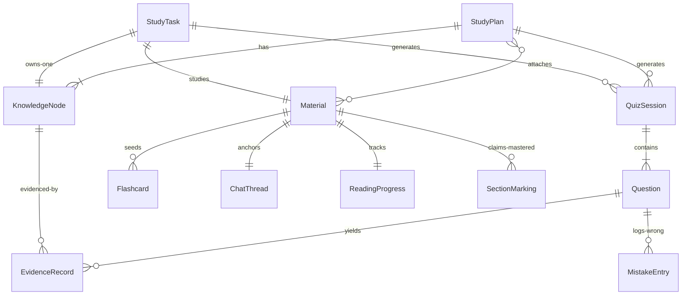
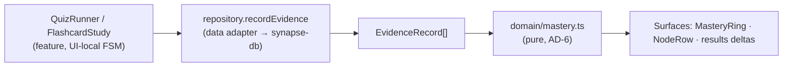

# Architecture Spine — Synapse · Frontend (Static-First Build)

**FR-29\*:** persistence binds as relaxed by owner decision 2026-11-02 — everything persists as localStorage JSON **except Material file blobs**, which are session-only (re-upload after reload). See AD-4.

**Scope line (owner, 2026-11-02):** build the static part first — the full interactive frontend with **simulated AI** behind an adapter and **local persistence**. Backend (accounts, sync, server-side AI FR-33, cost caps) is deferred to a later spine or an Update to this one; every deferral below leaves a seam, not a blocker.

## Design Paradigm

**Ports-and-adapters in the small.** A pure TypeScript **domain core** (entity types + logic) sits at the center; **feature modules** render it; exactly two **adapter seams** — `data` (persistence) and `ai` (Companion) — own all external effects. TanStack Query bridges features to adapters (cache, mutations, invalidation). The static build's "backend" is the current pair of local adapters; the future real backend is their replacement, behind unchanged interfaces.

```mermaid
flowchart LR
    subgraph adapters ["Adapters (replaceable)"]
        data ["src/data — repository interfaces\n+ localStorage adapter (now)\n+ HTTP adapter (later)"]
        ai ["src/ai — CompanionService\n+ simulated adapter (now)\n+ server adapter (FR-33, later)"]
    end
    subgraph core ["Domain core (pure)"]
        domain ["src/domain — entities\n+ mastery computation"]
    end
    subgraph ui ["Consumers"]
        features ["src/features/* (plan-first surfaces)"]
        pages ["src/pages/* (route shells\n+ retained scaffold pages)"]
    end
    query ["TanStack Query\n(cache · mutations · invalidation)"]
    pages --> features
    features --> query --> data
    features --> ai
    data --> domain
    ai --> domain
    features --> domain
```

## Invariants & Rules

### AD-1 — One paradigm: domain core + two seams

- **Binds:** all frontend units
- **Prevents:** half the surfaces reading a shared store and half inventing local shapes — the divergence that made the old scaffold's 13 pages unaggregatable (hubs FR-23/27/41/42 need one data shape)
- **Rule:** all domain data flows `features → (query) → data adapters`; all AI flows `features → ai adapter`. No third side-channel. The paradigm carries: when a new capability needs an external effect, it gets an adapter, not a fetch call in a component.

### AD-2 — Module boundaries & dependency direction

- **Binds:** `src/*` structure, all new code
- **Prevents:** cross-feature imports creating hidden coupling two builders can't see
- **Rule:** `pages → features → {domain, data, ai, components/ui, components/shared, contexts}`; `domain` imports nothing app-specific (pure TS, no React); `data → domain`; `ai → domain`; `components/shared → ui + lib + the LanguageProvider` (`t()` only). Features never import each other's **internals** — a feature may expose a named public surface (the reader's `parse(file)` API, the companion's exported `CompanionPanel`); imports beyond it are forbidden. Shared UI goes to `components/shared`, shared data through `data`, shared types through `domain`. `ReadingPosition` — locator (PDF page number | Markdown section id) + its extracted text — is a **domain type**: persisted progress, the reader's tracker, and CompanionService's grounding input all consume it verbatim; features never redefine it. Retained scaffold pages are **grandfathered** inside `pages/` as-is; each migrates into a feature module only when its FR re-points it (FR-25/26/28/36), never in a big-bang refactor.

### AD-3 — Data ownership: repositories + Query, no domain contexts

- **Binds:** all domain entities and their mutation paths
- **Prevents:** two ownership systems (context setState vs. repository) racing for the same entity
- **Rule:** repository interfaces in `src/data` are the single owner of domain entities (StudyPlan, KnowledgeNode, Material, StudyTask, QuizSession, Question, EvidenceRecord, Flashcard, MistakeEntry, ReadingProgress, ChatThread). Features read/write only via repositories, consumed through TanStack Query (`useQuery`/`useMutation` + invalidation). **No new React contexts for domain data** — contexts are reserved for cross-cutting UI concerns (language). `UserProgressContext` is frozen as retained demo garnish; new plan-first surfaces never write to it; it retires as plan evidence re-points the retained pages.

### AD-4 — Local store: one versioned localStorage document

- **Binds:** FR-29 (as relaxed), all persisted data
- **Prevents:** per-feature localStorage keys with clashing shapes and no migration path
- **Rule:** a single key `synapse-db:v1` holds one JSON document with a schema `version` field; the local adapter owns full-document synchronous writes and migrations. localStorage's other role stays exactly as-is: `synapse-lang` (UI pref). **Material file blobs are the only session-only data** (owner decision 2026-11-02) — a reload re-uploads; metadata, extracted page/section text + parse state (bounded per-section size, so one document cannot blow the ~5MB quota), evidence, chat, reading positions, and the onboarding-complete flag persist. Revisit: if reload pain shows in real use, add an IndexedDB blob adapter inside `data/` — features untouched.

### AD-5 — AI seam: CompanionService now, FR-33 later

- **Binds:** FR-11, FR-12, FR-18, FR-19, FR-33-deferred
- **Prevents:** components coupling to a provider API (or to fake `setTimeout`s) that the server integration must then hunt down
- **Rule:** `src/ai` defines `CompanionService` — chat grounded on a Reading Position, **plan-structure generation** (topic/goal → staged node proposal for the creation chat, streamed like chat), quiz generation by mode from material refs (**questions return node-attributed**, AD-6), flashcard generation, open-answer grading with rationale — and ships a **deterministic simulated implementation** (keyword-routed, artificial delay, streamed emission) for the static build. The server-side implementation (FR-33) replaces it behind the same interface. The plan-creation transcript is ephemeral until the plan is confirmed (a ChatThread anchors to a Material; none exists yet). Guardrail posture (NFR-2) is carried by the structured response contract (intent, rung, citations) per EXPERIENCE.md — the UI renders the contract, never guesses it. No component performs AI/network calls directly.

### AD-6 — Mastery Score is one pure function

- **Binds:** FR-3, FR-20-frontend, SM-3, SM-C2
- **Prevents:** Plan Home, Task home, Dashboard, and Analytics each computing rollups differently — the number stops meaning one thing
- **Rule:** `domain/mastery.ts` holds the single implementation: EvidenceRecords → per-Knowledge-Node score (uncovered / partial / mastered vocabulary per EXPERIENCE.md) → plan rollup, where **rollup reaches 100% only when every node is mastered**. Every generated Question carries **node attribution at generation time** — `EvidenceRecord.nodeId` is required in Phase 1 (a whole-plan quiz attributes coarsely via the plan's node list; Phase 2 defers node-*targeted* generation, never attribution). Every Study Task owns exactly one auto-created KnowledgeNode (`taskId` set, `planId` null); plan rollups and plan-node listings select by `planId`, and the task rollup reads its single node — no other rollup exists. `domain/` owns **all** evidence-derived rollups — mastery, and the FR-25 streak's consecutive-evidence-days (SM-C3) — under this same rule; no surface computes its own. Weighting, partial credit, and decay values are OQ-9 → spec; placement here is fixed.

### AD-7 — Client-side document rendering

- **Binds:** FR-8, FR-9, FR-10
- **Prevents:** reader implementations drifting on engine choice; resolves OQ-5 for this scope
- **Rule:** PDF: **pdfjs-dist 6.x** — page-by-page rendering plus per-page text extraction (the Reading Position's content). Markdown: **react-markdown 10.x + rehype-slug 6.x** — hierarchical headings with stable section IDs. Both live inside the reader feature, which exposes a public `parse(file) → { sections, text, state }` extraction API (progress, failure, retry) callable from plan/task upload flows; pdfjs-dist is dynamically imported only there (AD-8). Server-side parsing revisits with the backend spine.

### AD-8 — Routing: front door at `/`, sessions are routes

- **Binds:** FR-1, FR-36, FR-37, UX IA table
- **Prevents:** quiz/flashcard sessions built as unaddressable modal stacks; landing-page ambiguity
- **Rule:** react-router 6 (inherited). `/` renders Onboarding on first run, then **Plans Home** — the front door; `/plans` addresses the same surface. The onboarding-complete flag is a field of the `synapse-db` document (AD-4); when FR-1 lands, Onboarding's ready step — and any scaffold "home" redirect — navigates to `/`. Plan-first routes: `/plan/new`, `/plan/:id`, `/task/new`, `/task/:id`, `/read/:materialId`. In-flow quiz and flashcard sessions are focused **sub-routes** (`/plan/:id/quiz`, `/task/:id/quiz`, `/plan/:id/flashcards`, …), never modals. The reader route accepts position anchors (`?page=N` / `#section-id`, plus a transient highlight flag) — the **only** cross-feature command channel into the reader (CitationChip clicks, continue cards). Retained scaffold routes unchanged until their FR re-points them. **pdfjs-dist is dynamically imported only inside the reader feature** — no other module imports it directly.

### AD-9 — Scaffold conventions bind new surfaces [ADOPTED]

- **Binds:** all UI code
- **Prevents:** new surfaces restyling around raw palette classes or hardcoded strings
- **Rule:** i18n via the `translations` table + `t()` with zh+en parity (NFR-5) — never hardcoded strings; semantic Tailwind tokens + shadcn/ui primitives; `cn()` for conditional classes; TypeScript stays loose (not tightened); **sonner** is the single toast pattern; the EXPERIENCE.md **Accessibility Floor binds all new surfaces** (WCAG 2.2 AA, keyboard-complete quiz, never-color-only study states, reduced-motion collapse). Domain entities are **language-neutral**; the bilingual `Record<zh,en>` demo-data pattern stays a retained-page pattern only.

### AD-10 — Testing posture

- **Binds:** domain + dense-behavior features
- **Prevents:** the one algorithm the product promises (mastery) shipping unverified
- **Rule:** vitest unit tests are mandatory for `domain/` (mastery first: uncovered-never-green, rollup cap, evidence-only movement) and for dense behavior (quiz attempt gate, reading-position tracking). Gates: `npx tsc -b` + `npm run lint` + `npm run test`. E2e deferred (Playwright config dep absent — open item).

### AD-11 — Deployment: static SPA host

- **Binds:** FR-35, NFR-6
- **Prevents:** deploy-time surprises from client-side routing or env assumptions
- **Rule:** `vite build` produces a static bundle; deploy to a static host with **SPA-fallback rewrite to `index.html`** and auto-deploy from `main`. No env vars, no server, no warm-up (NFR-6). Vendor choice (Vercel / Netlify / Cloudflare Pages — all satisfy) is a deploy-task decision, not an architectural one.

## Consistency Conventions

| Concern | Convention |
| --- | --- |
| Naming | Entities/files PascalCase types, camelCase fields; feature dirs kebab or singular-noun (`features/plans`, `features/reader`); query hooks `use<Entity>Queries` inside `data/` |
| Data & formats | ids = `crypto.randomUUID()` strings; dates = ISO 8601 strings; store = single `synapse-db:v1` document with `version` field |
| State & mutation | domain data only via Query + repositories (AD-3); UI-local state (quiz FSM, panel collapse) stays in components; mutations invalidate affected query keys |
| Errors | adapters throw typed `AppError { code, messageKey? }`; features map to sonner toasts — never silent, never fake success (UX State Patterns) |
| Config | none for the static build (simulated AI is code); new env needs arrive with the backend adapters |

## Stack

| Name | Version |
| --- | --- |
| TypeScript (loose config, per AGENTS.md) | ^5.8.3 |
| React | ^18.3.1 |
| Vite | ^5.4.19 |
| react-router-dom | ^6.30.1 |
| @tanstack/react-query | ^5.83.0 |
| shadcn/ui (Radix) + Tailwind CSS-variable tokens | 46 primitives · tailwind ^3.4.17 |
| framer-motion / recharts / sonner | ^11 / ^2.15.4 / ^1.7.4 |
| **pdfjs-dist** (new — reader) | 6.x |
| **react-markdown + rehype-slug** (new — reader) | 10.x · 6.x |
| vitest + Testing Library | ^3.2.4 · ^16 |

## Structural Seed

```text
src/
  domain/        # pure TS: entity types, mastery.ts (AD-6). No React imports.
  data/          # repository interfaces, local localStorage adapter (AD-3/4), query keys
  ai/            # CompanionService interface + simulated adapter (AD-5)
  features/      # plans/ · tasks/ · reader/ · companion/ · quiz/ · flashcards/ (AD-2)
  pages/         # thin route shells for plan-first routes + grandfathered scaffold pages
  components/    # ui/ (shadcn stock) · shared/ (cross-feature presentational)
  contexts/      # LanguageProvider (UI i18n); UserProgressContext frozen (AD-3)
  lib/ hooks/    # as-is (cn(), use-mobile)
```

**Core entities (names + ownership only; fields refine at spec time — all owned by `data/`, AD-3):**



**Evidence loop (the product's core data flow):**



## Capability → Architecture Map

| Capability / Area | Lives in | Governed by |
| --- | --- | --- |
| FR-1 entry states, Plans Home | `features/plans` + `/` route + `src/ai` plan generation | AD-8, AD-2, AD-5 |
| FR-2 material attach (UploadDropzone) | `features/plans` + `data` Material repo + reader `parse(file)` API | AD-3, AD-7 |
| FR-3 Mastery Score | `domain/mastery.ts` + `components/shared/MasteryRing` | AD-6 |
| FR-8/9/10 reader + Reading Position | `features/reader` | AD-7, AD-8 |
| FR-11/12 Companion chat + guardrails | `features/companion` + `src/ai` | AD-5 |
| FR-18/19 quiz + flashcard generation | `features/quiz`, `features/flashcards` + `src/ai` | AD-5, AD-8 |
| FR-25 plan home (light) + streak | `features/plans` + `domain` streak rollup | AD-2, AD-6 (dashboard re-points later) |
| FR-29 persistence | `data` local adapter | AD-4 (relaxed: blobs session-only) |
| FR-32 bilingual UI | `contexts/LanguageProvider` + `t()` | AD-9 |
| FR-35 deployment | host contract | AD-11 |
| FR-36 IA / sidebar ordering | routes + `AppLayout` | AD-8 |
| FR-37 Study Task | `features/tasks` | AD-2, AD-8 |
| FR-13/14/15 (stretch) | `features/reader` selection bar / marking | AD-7; detail at spec |

## Deferred

| Decision | Revisit when |
| --- | --- |
| Backend stack (OQ-3), AI provider + terms (OQ-4), server-side AI execution (FR-33), accounts/sync (FR-30/31), privacy enforcement (FR-4), cost cap (FR-34) | backend work starts — a second spine or an Update to this one; the `data`/`ai` seams are the handoff surface |
| Server-side PDF parsing (OQ-5 residual) | backend spine (client-side chosen here, AD-7) |
| Roadmap renderer, graph vs custom SVG (OQ-2) | FR-5 build (Phase 2) |
| Note enrichment sourcing (OQ-11) | FR-40 build (Phase 2) |
| Re-queue algorithm (OQ-6); mastery weighting/decay values (OQ-9) | implementation spec (`/to-spec`) — placement already fixed by AD-6 |
| Material blob persistence (IndexedDB) | reload pain in real use (owner accepted re-upload, 2026-11-02) |
| Hosting vendor | deploy task (contract fixed by AD-11) |
| E2e tooling (Playwright dep absent from package.json) | post-deadline hardening |
| Bundle code-splitting beyond lazy pdfjs | if demo load time hurts (NFR-6) |
| Hubs build (FR-23/27/41/42) | Phase 2 — retained `/mistakes` `/planner` `/flashcards` `/quiz` pages stand in through Phase 1; HubPlaceholder applies only if the sidebar re-orders before hubs land |
