# Synapse — UI Redesign Handoff Package

**Prepared:** 2026-11-01 · **Repo:** `/Users/zhaoyinan/document/Polyu/COMP5241 软工/project-new` · **Branch:** `main`
**Purpose:** everything a redesign agent needs to restyle the current `/src` implementation while respecting the planned product direction in `/docs`.

**The one-sentence brief:** restyle and restructure the UI of a bilingual (中文/English) AI study app — keep all product logic, routes, i18n machinery, and the retained 10-page IA intact; push the visual system toward the "quiet intelligence" direction already specified in `docs/design/ux-synapse/DESIGN.md`.

---

## 0. Read-first order (these docs bind the redesign)

Per `docs/design/README.md`: *"read before implementation planning for any UI-touching work — UX decisions here bind tickets and code."* On conflict, the UX spine wins over mockups.

| Doc | Status | Why it matters |
|---|---|---|
| `docs/design/ux-synapse/DESIGN.md` | final | Visual identity spine: tokens, typography, component specs, Do/Don't |
| `docs/design/ux-synapse/EXPERIENCE.md` | final | Behavior spine: IA table, voice & tone, AI guardrails, states, a11y floor, responsive rules |
| `docs/product/prd-synapse/prd-synapse.md` (+ `addendum.md`) | final | 46 FRs — scope + non-goals |
| `docs/product/brief-synapse/brief-synapse.md` (+ `addendum.md`) | approved | Product concept, brand origin, research grounding |
| `AGENTS.md` (repo root) | current | The real project doc: architecture, conventions, gotchas. `README.md` is a Lovable stub — ignore it |
| `docs/architecture/` | empty | Placeholder only — no architecture spine/ADRs yet; no API contracts exist |

---

## 1. Repo & commands

```bash
npm install        # deps are already installed in this working copy (node_modules present, pnpm-lock.yaml untracked)
npm run dev        # Vite dev server → http://localhost:8080 (NOT 5173); binds host ::; HMR overlay disabled
npm run build      # vite build ONLY — does NOT typecheck
npx tsc -b         # explicit typecheck (no `typecheck` script exists)
npm run lint       # eslint 9 flat config
npm run test       # vitest run (watch: npm run test:watch) — jsdom, globals on, setup in src/test/setup.ts
npm run preview    # serve the production build
```

Gotchas:

- **`npm run build` passing ≠ types are fine** — always run `npx tsc -b` for type safety.
- Dev errors appear only in the **terminal** (HMR overlay is off in `vite.config.ts`) — watch it, not just the browser.
- Playwright e2e is configured (`playwright.config.ts`) but its dep `lovable-agent-playwright-config` is **not** in `package.json` and no e2e specs exist — don't rely on e2e.
- A dev server is **already running** on port 8080 in this workspace (user-started, live HMR). Verify before starting a second one.
- `tsconfig.*.tsbuildinfo` are committed; stale incremental artifacts → `npx tsc -b --clean`.

---

## 2. Styling stack & component library

| Layer | Choice | Where |
|---|---|---|
| Build | Vite 5 (`@vitejs/plugin-react-swc`) + `lovable-tagger` (dev-mode component tagging) | `vite.config.ts` |
| UI framework | React 18.3 + TypeScript 5.8 (deliberately loose — see §7) | |
| Routing | `react-router-dom` 6.30 | `src/App.tsx` |
| Styling | **Tailwind 3.4** with CSS-variable HSL tokens + `tailwindcss-animate` | `src/index.css` (tokens), `tailwind.config.ts` (mapping) |
| Component kit | **shadcn/ui** (default style, slate base, `cssVariables: true`) on Radix primitives + CVA | `src/components/ui/*` (50 files), `components.json` |
| Icons | `lucide-react` 0.462 | |
| Animation | `framer-motion` 11 (`AnimatedSection`/`AnimatedCard`, `ProgressRing`) + Tailwind keyframes (`pop`, `slide-up`, `fade-in`, `pulse-glow`, `confetti`) | `tailwind.config.ts`, `src/components/shared/` |
| Charts | `recharts` 2.15 (Analytics page) | |
| Forms | `react-hook-form` + `@hookform/resolvers` + `zod` are installed (barely used yet) | |
| Data | TanStack Query 5 mounted but **no API layer**; no backend; everything else is mock | `src/App.tsx`, `src/contexts/UserProgressContext.tsx` |
| Toasts | **Both** shadcn `<Toaster />` and `<Sonner />` are mounted in `App.tsx` — the redesign must pick ONE pattern and stay consistent | `src/App.tsx` |
| Class utils | `cn()` = clsx + tailwind-merge — use for ALL conditional classes | `src/lib/utils.ts` |
| Fonts | Outfit (display) + Inter (body), Google-Fonts `@import` in CSS; CJK falls to system (PingFang SC / Microsoft YaHei / Noto Sans SC) | `src/index.css:1`, `tailwind.config.ts` `fontFamily` |

Tailwind theme conventions (must keep): semantic token classes only (`bg-background`, `text-muted-foreground`, `bg-primary`, `bg-card`, `bg-sidebar-*`) — **never raw palette classes** (exception: annotation pastels per DESIGN.md). Custom utilities `font-display` / `font-body`. Container = centered, `2rem` padding, `2xl: 1400px`. Border radius derived from `--radius: 0.625rem` (soft 10px look).

**Dead files (safe to remove in the redesign):** `src/App.css` (Vite-template leftover, imported by nothing) and `src/tailwind.config.lov.json` (Lovable artifact, referenced by nothing).

---

## 3. Key routes, screenshots, working local preview

**Working local preview:** <http://localhost:8080> (live dev server, serves this directory with HMR). If not running: `npm run dev`.

Routes are defined in `src/App.tsx`. `/` = `OnboardingPage` (standalone); all other pages nest under `AppLayout` (sidebar shell). Language default is **zh** (`localStorage["synapse-lang"]`, fallback zh).

| Route | Page file | Screenshot (1440×900, zh unless noted) |
|---|---|---|
| `/` | `src/pages/OnboardingPage.tsx` | 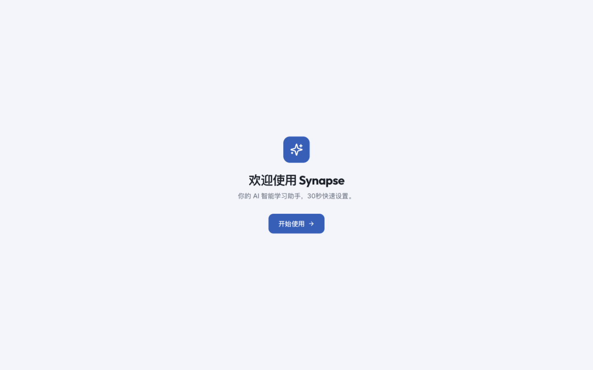 |
| `/dashboard` | `src/pages/DashboardPage.tsx` | 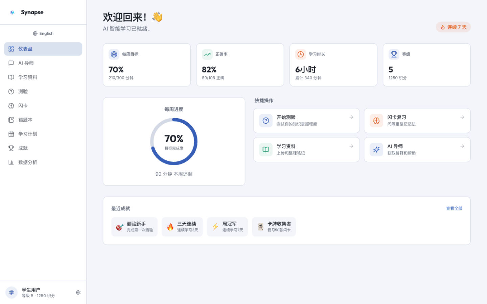 |
| `/ai-tutor` | `src/pages/AITutorPage.tsx` | 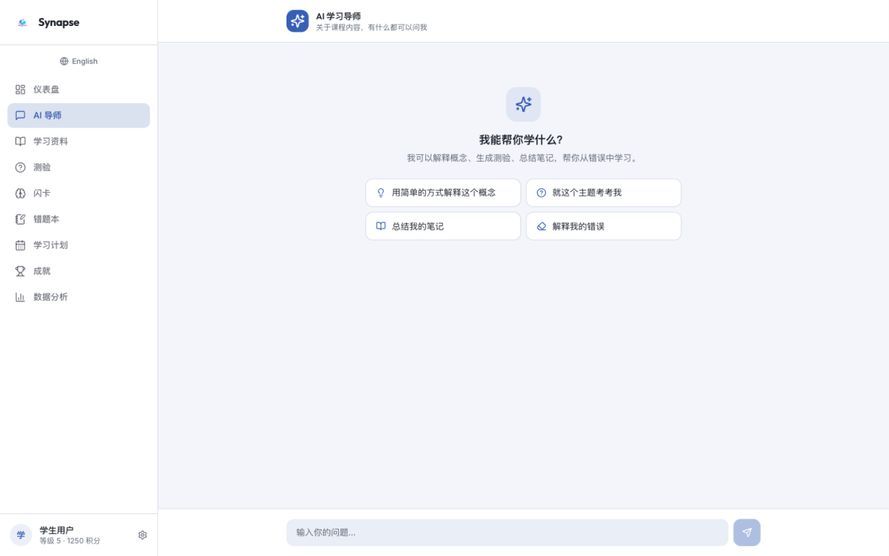 |
| `/materials` | `src/pages/MaterialsPage.tsx` | 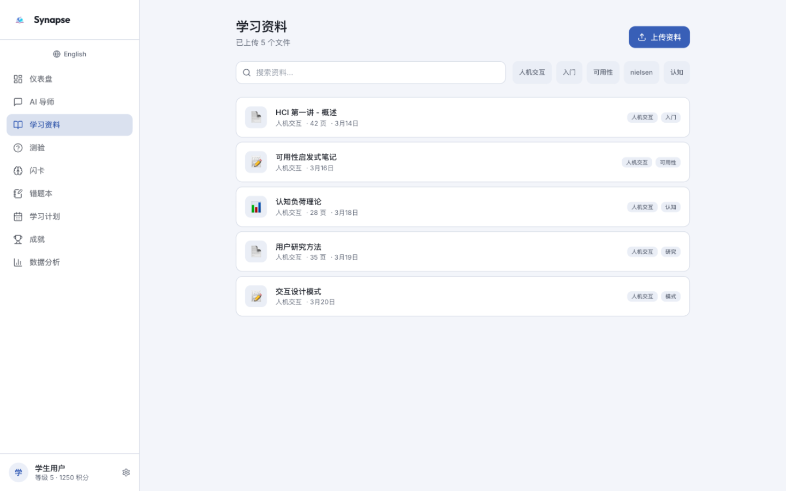 |
| `/quiz` | `src/pages/QuizPage.tsx` (269 lines — largest page) | 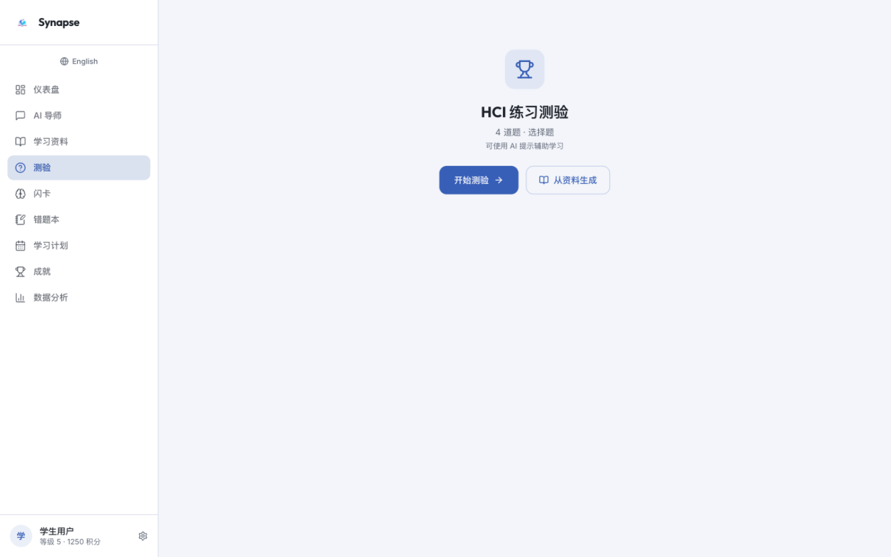 |
| `/quiz` — runner state (after 开始测验) | same | 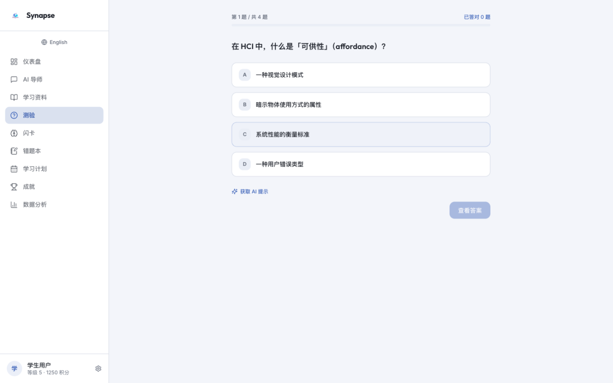 |
| `/flashcards` | `src/pages/FlashcardsPage.tsx` | 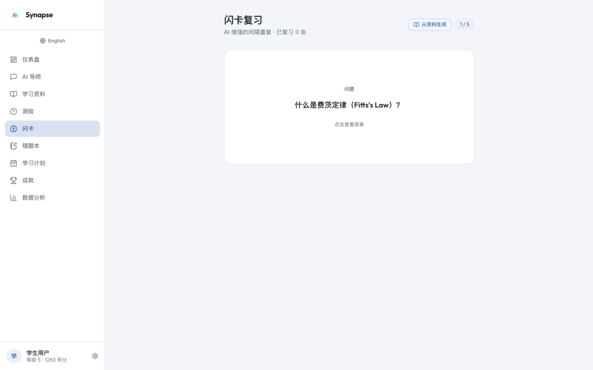 |
| `/mistakes` | `src/pages/MistakesPage.tsx` | 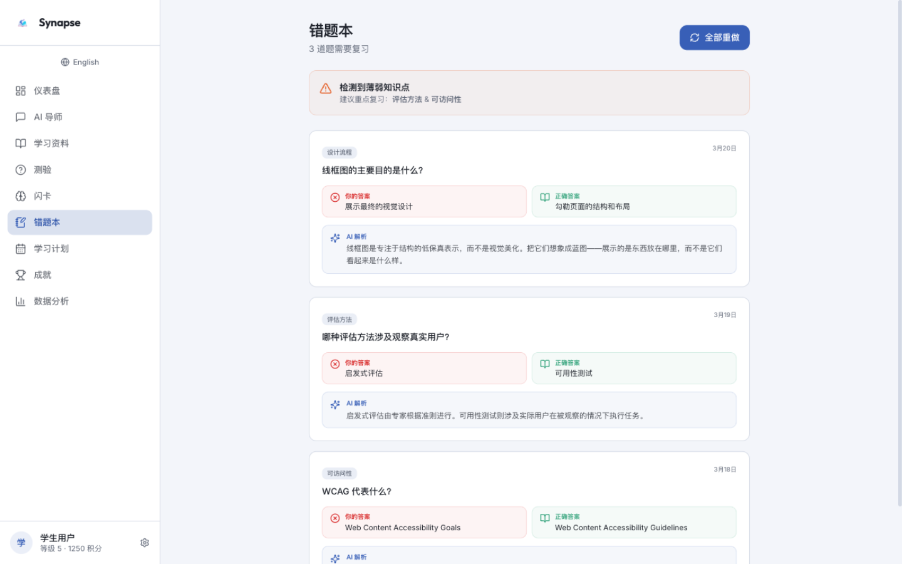 |
| `/planner` | `src/pages/PlannerPage.tsx` | 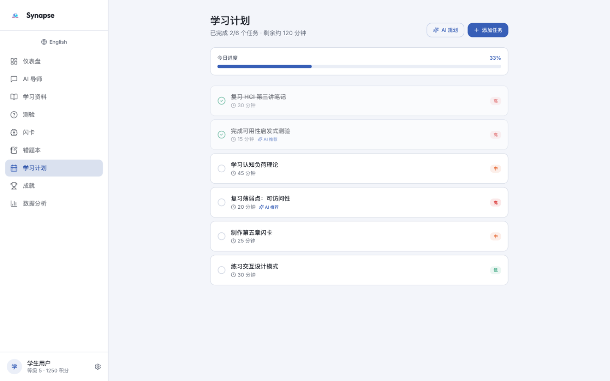 |
| `/achievements` | `src/pages/AchievementsPage.tsx` | 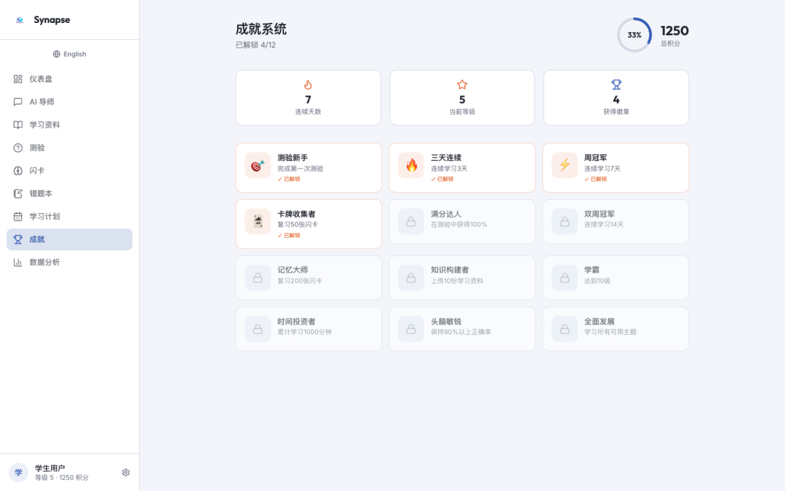 |
| `/analytics` | `src/pages/AnalyticsPage.tsx` (recharts) | 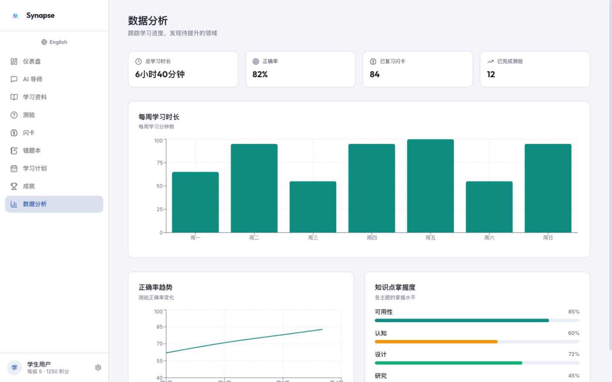 |
| `/settings` | `src/pages/SettingsPage.tsx` | 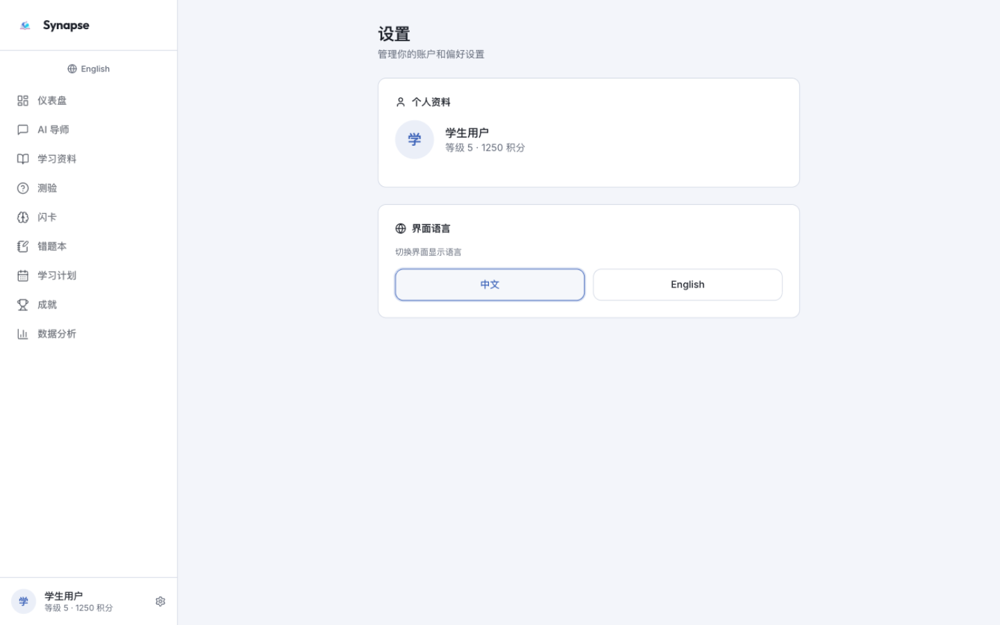 |
| `/dashboard` — **English** UI | | 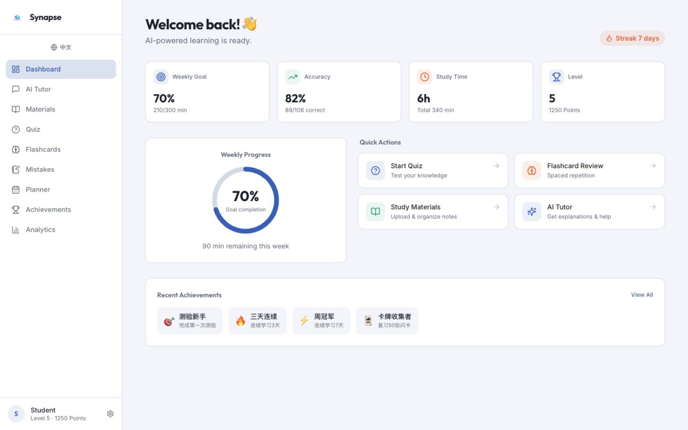 |
| `/dashboard` — **mobile 390×844** | | 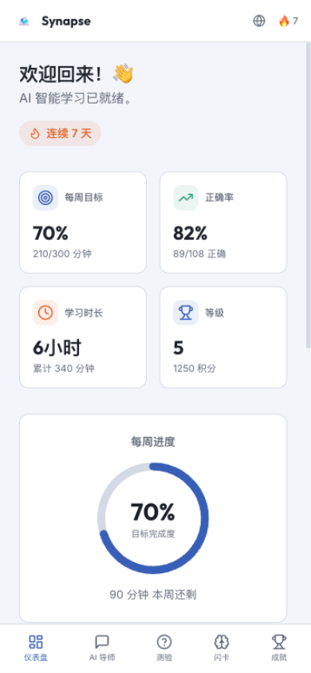 |
| any unknown | `src/pages/NotFound.tsx` | — |

All screenshots live in `docs/design/redesign-handoff/screenshots/` (this folder). Planned-but-not-built routes from the PRD/UX spine (build targets, not redesign scope unless asked): Plans Home (FR-1), `/plan/new`, `/plan/:id`, `/task/new`, `/task/:id`, `/read/:materialId`, 4 hub pages (FR-36).

---

## 4. Brand assets & design references

**Brand:** **"Synapse" stays "Synapse" in both languages** — no translated Chinese name (owner decision). Tagline: 「你的 AI 学习伙伴 — 每一次提问，都在强化一条连接」 / "The AI study companion that strengthens your connections." Neural metaphor (Hebb's rule: connections strengthen with use).

**Assets in repo:**

- `public/favicon.png` + `public/favicon.ico` — the spark/synapse mark (used in sidebar logo + mobile header at 28–32px, rounded-lg)
- `public/placeholder.svg` — generic placeholder
- `index.html` — title `Synapse — AI 学习伙伴`, bilingual meta/OG/Twitter tags, remote OG image URL (Lovable CDN)

**Color tokens (light theme ONLY — dark mode is explicitly rejected for Phase 1):** full set in `src/index.css` — hue-220 blue system: `--primary: 220 50% 50%` (#406ABF family), `--background: 220 40% 97%` (#F4F6FA), `--foreground: 220 20% 15%`, `--destructive: 0 72% 51%`, plus `--amber`/`--emerald` extras and a full `--sidebar-*` set. DESIGN.md adds a **study-state semantic layer** that the current code does NOT have yet (the redesign should add it as tokens):

- mastered `#39AC86` (emerald) + tint `#E6F4EE` · partial `#E86E30` (amber) + tint `#FBEEE6` · uncovered-tint `#EDF0F7` · citation-tint `#ECF0F9`
- **Blue = brand/action, never a mastery/progress color.**
- Contrast facts (DESIGN.md): primary-on-white 5.2:1 (AA ✓); mastered solid as small text 2.8:1 (✗ — carry state via tints/icons/borders, not text color); muted-foreground on background ≈4.4:1 (captions only).

**Design references (EXPERIENCE.md §Inspiration):** roadmap.sh (node/state vocabulary: done/in-progress/skipped → mastered/partial/uncovered), the scaffold's own patterns (chat surface, quiz hint button, flashcard difficulty trio, mistake compare cards, quick-action tiles, 12-badge taxonomy), modern chat surfaces (streaming + citation chips, but page-grounded + hint-first), Anki (recall-before-flip).

**HTML mockups (visual direction, NOT pixel specs; sidebar chrome inside them is stale — spine wins):**

- `docs/design/ux-synapse/mockups/key-plans-home-empty.html` — front-door empty state (agent-style creation chat)
- `docs/design/ux-synapse/mockups/key-plan-home.html` — Plan Home light (mastery rollup rail)
- `docs/design/ux-synapse/mockups/key-reader-companion.html` — Immersive Reader + Companion split view
- `docs/design/ux-synapse/mockups/key-quiz.html` — Quiz runner + results (states A/B in comments)

**Rejected directions (do not reintroduce):** dark mode (Phase 1), engagement nudges/toasts, time-in-app displays, AI-vs-manual charts, sparkle-storm chrome, neural-network wallpaper, celebration loops (one confetti moment, ever).

---

## 5. Target users, priority workflows, UX pain points

### 5.1 Target users

- **Primary:** university students (PolyU context) studying several subjects at once, bilingual 中文/English, exam-driven; already use AI but pay a "context tax" re-explaining context every session. The author is the first user.
- **Secondary:** classmates + COMP5241 lecturer viewing it as course evidence (AI Fluency 4D framework).
- **Personas (PRD §2.3):** Yinan (builder; 5-day exam prep, reads lecture-slide PDFs) and Wei (classmate; "one PDF understood tonight", paints mastery green before exams).
- **Non-users v1:** instructors, study groups (no collaboration, no instructor flows).

### 5.2 Priority workflows (design the redesign around these, in order)

1. **Study Plan = front door** (FR-1, FR-25, FR-2) — empty state invites plan creation via agent-style chat; returning users get "continue where you left off"; system gives plans, **never content**; user attaches own materials (PDF/Markdown ≤20MB, FR-2).
2. **Study Task** (FR-37) — plan-free single-document study with identical machinery; routes `/task/new`, `/task/:id`.
3. **Immersive Reader + Companion** (FR-8/9/10/11/12) — reading is sacred: maximal reader area, minimal chrome, side chat that knows the Reading Position and cites it; hint-first guardrails ("a ladder, never a wall"); stretch: selection shortcuts, Quick Test, Mastery Marking, annotations (FR-13–17).
4. **Quiz generation in-flow** (FR-18) — Open / Choice / Mix only, strictly materials-sourced (NFR-1); QuizLauncher → QuizRunner (one question at a time, attempt-gated, free hint, forfeit = wrong) → QuizResults with mastery deltas + mistake compare cards.
5. **Mastery Score loop** (FR-3, FR-20) — per-node 0–100% from quiz evidence only; states `uncovered` / `partial (1–79%)` / `mastered (≥80%)`; plan rollup shows 100% only when **every** node is mastered; marking is a claim that invites a confirm quiz, never evidence.
6. **Companion beyond the reader** (FR-46) — plan-level sidebar tutor with intent chips (解释/考我/总结/分析错题); `/ai-tutor` stays as the plan-free chat destination (Phase 1 = honest keyword demos).
7. **Today / 今日学习** (FR-27) — daily task list hub (weak-spot tasks + due reviews + manual tasks); NOT a calendar. zh label 学习计划 currently on Planner renames when this lands.
8. **Mistakes + Flashcards + Quiz hubs** (FR-23/24/41/42) — sidebar aggregates cross-plan output; generation happens in-flow only; Phase 1 hubs render honest `HubPlaceholder` cards (no fake data).
9. **roadmap.sh import** (FR-43, with FR-5/44/45) — import a public roadmap as a ready-made plan; interactive node graph (renderer = open question OQ-2); 「plan 是骨架、材料是血肉」.

### 5.3 UX pain points — current implementation (observed in this repo/screenshots)

**Product-level (from brief):** AI is context-blind (context tax); study tooling is fragmented; "nobody schedules forgetting." The redesign's visual job is to make the fix *feel* like **"quiet intelligence"** — calm, focused, honest; coach not examiner; anti-sycophancy (no 「好问题！」, no praise inflation); no engagement bait.

**Implementation-level defects the redesign should fix (evidence in screenshots):**

1. **i18n leaks:** in EN mode, Dashboard's recent-achievement chips still render Chinese (测验新手 / 三天连续…) — achievement titles/descriptions come from `UserProgressContext` mock data as hardcoded zh strings, bypassing `t()`. Any redesigned mock data must route through i18n.
2. **Sparse pages / dead whitespace:** AI Tutor, Quiz landing, Settings, Flashcards have huge empty vertical stretches at 1440×900 — no content hierarchy to anchor the eye; Onboarding is a bare centered card.
3. **Off-token chart colors:** Analytics bars/lines use raw teal/green/amber not derived from semantic tokens; the topic-strength bars partially reuse `--emerald`/`--amber` but the charts don't follow the DESIGN.md chart accent set.
4. **No keyboard/interaction affordances in quiz runner:** options are clickable cards with no `1–4` key hints, no focus-visible styling, no `aria-live` verdict announcement (required by the a11y floor, §6).
5. **Mastery/progress semantics absent:** everything reads generic blue; no study-state tint system (mastered/partial/uncovered) anywhere yet — the DESIGN.md semantic layer is entirely unbuilt.
6. **Sidebar info scent is flat:** 9 equal-weight items + language toggle as a text button; profile footer exists (avatar 学/S, name, 等级·积分 line, settings gear — this footer is RETAINED IA) but no grouping of the 4 hubs (FR-36) that the IA plans.
7. **Mock-data honesty:** stats (1250 points, streak 7, 82% accuracy…) are in-memory and reset on reload — per PRD this is acceptable Phase 1, but surfaces should not imply persistence, and points/level must stay read-only garnish (FR-28).
8. **Dead code:** `src/App.css`, `src/tailwind.config.lov.json` (see §2).
9. **Two toast systems mounted simultaneously** (shadcn Toaster + Sonner) — pick one.

---

## 6. Responsive, browser & accessibility requirements

From `EXPERIENCE.md` (§Foundation, §Accessibility Floor, §Responsive & Platform) — these are binding requirements, not suggestions:

**Platform:** responsive web only, no native apps. Desktop ≥1024px is primary (student laptop + Nov 6 projector demo); tablet 768–1023px must stay reading-competent; mobile <768px keeps read + chat + review usable ("generation and quiz sessions work but are not optimized").

**Breakpoint contract:**

| Range | Sidebar | Companion (future reader) | Chrome |
|---|---|---|---|
| ≥1024px (`lg`) | full 256px | docked right 400px (420px at ≥1280px) | as now |
| 768–1023px (`md`) | icon rail | right overlay | as now |
| <768px | hidden | bottom sheet ~65dvh with drag handle | mobile header (logo · language · 🔥 streak) + **bottom nav of 5** (Dashboard, AI Tutor, Quiz, Flashcards, Achievements) — re-cut to Plans + hubs when FR-1 lands |

Current mobile implementation (`AppLayout.tsx`) already matches the header/bottom-nav shape (see screenshot 13) but uses a text language button and no `md` icon rail (sidebar is simply `hidden` below `md` — the 768–1023px rail is **missing**).

**Accessibility floor (WCAG 2.2 AA):**

- Quiz fully keyboard-complete: `1–4` select, Enter confirm/next, Esc exit-with-confirm; focus moves question-to-question; verdict announced `aria-live="polite"`.
- Study states never color-only — glyph + label + tint everywhere (green-only mastery fails colorblind users; mastered solid already fails AA as small text).
- Companion streaming announced once on completion; Tab order = reading order; Esc closes topmost layer; 200% text zoom reflows without horizontal-scroll traps; `prefers-reduced-motion` collapses ALL animation to instant (confetti → static badge).
- Contrast targets per §4.
- **Banned everywhere:** hover-only affordances on touch, modal stacks >1 deep, infinite scroll, auto-playing audio, engagement toasts.

**Browsers:** no explicit matrix is pinned anywhere in docs — treat as modern evergreen (Chrome/Safari/Firefox/Edge current + Safari iOS). Typography/scrollbar CSS already assumes evergreen (`::-webkit-scrollbar` custom, `text-wrap: balance/pretty`).

---

## 7. Business logic & invariants that MUST remain unchanged

The redesign is visual/structural, **not** a logic rewrite. These are the load-bearing rules:

1. **Provider order & app shell** (`src/App.tsx`): `QueryClientProvider → TooltipProvider → LanguageProvider → UserProgressProvider → BrowserRouter`; exactly these two app contexts (LanguageProvider → UserProgressProvider). Hooks `useLanguage()` / `useUserProgress()` throw outside their providers.
2. **Route table** (`src/App.tsx`): `/` = OnboardingPage standalone; `/dashboard /ai-tutor /materials /quiz /flashcards /mistakes /planner /achievements /analytics /settings` under `AppLayout`; `*` → NotFound. The 10-page retained IA is owner-locked (FR-25/26/28/36/46); do not retire pages.
3. **i18n machinery** (`src/contexts/LanguageContext.tsx`): every user-facing string is a dotted key `{ zh, en }` in `translations` (~173 keys today) rendered via `t("key")` with `{var}` interpolation; missing key renders the key itself. Language persists in `localStorage["synapse-lang"]`; default **zh**; switching is instant, no reload. **Adding any string without both languages is a bug (NFR-5).** Fix the mock-data zh leak (§5.3) rather than bypassing this.
4. **UserProgress contract** (`src/contexts/UserProgressContext.tsx`): shape `{ points, streak, level, quizzesCompleted, flashcardsReviewed, studyMinutes, correctAnswers, totalAnswers, achievements[], weeklyGoal, weeklyProgress }` + mutators (`addPoints` w/ level = floor(points/500)+1, `incrementStreak`, `addStudyMinutes`, `recordAnswer`, `completeQuiz`, `reviewFlashcard`, `unlockAchievement`). In-memory (resets on reload) — that's Phase 1-correct (FR-29 says local persistence is the target, not yet built). Points/level = **read-only garnish** (FR-28): keep visible in sidebar footer + Achievements, build nothing new on points/minutes/logins.
5. **Mastery semantics** (FR-3/15/20, NFR-8): evidence-only; updates on grading; `uncovered` never renders green; rollup = 100% only when all nodes mastered; marking = claim → confirm quiz; formula must stay swappable behind one module; thresholds (80 / 1–79) are display assumptions.
6. **Quiz rules** (FR-18, NFR-1/8): Open + Choice (+Mix) only; strictly materials-sourced; recall before reveal; forfeit ("Show answer") = counted wrong + logged; retakes produce fresh questions.
7. **AI behavior** (NFR-2): hint-first, escalation always available; grounding honesty (cite Reading Position; label beyond-material answers). Phase 1 `/ai-tutor` = keyword demos with 1.2–2.0s typing delay, never claiming real grounding. Server-side AI only (FR-33) — no provider key ever reaches the client.
8. **Streak semantics** (FR-25): consecutive days with ≥1 evidence-producing session — never minutes/logins.
9. **Sharing boundary** (NFR-7): public plans expose structure only — never materials/annotations/mastery.
10. **TypeScript is deliberately loose**: `strict:false`, `noImplicitAny:false`, `strictNullChecks:false`, unused checks off. **Do not tighten or bulk-annotate in the redesign.**
11. **Path alias `@/* → src/*`** declared in FOUR synced places: `vite.config.ts`, `vitest.config.ts`, `tsconfig.json`/`tsconfig.app.json` — keep in sync.
12. **No backend/API exists.** TanStack Query is mounted but unused; do not invent API calls. Future contracts (server-side AI FR-33, accounts FR-30, sync FR-31, cost cap FR-34) are deferred to `/bmad-architecture`.
13. **No manual/dual mode anywhere** — `LearningModeContext`, `aiOnly` gating, mode toggle, onboarding mode step are already removed (owner decision 2026-11-01). Never reintroduce.

---

## 8. Shared layout / theme / component file map (where each redesign dimension lives)

### Theme & tokens
| Concern | File |
|---|---|
| All HSL color tokens, radius, fonts (CSS layer) | `src/index.css` |
| Tailwind mapping of tokens, `font-display`/`font-body`, keyframes (`pop`, `slide-up`, `fade-in`, `pulse-glow`, `confetti-fall`), container, sidebar color group, `amber`/`emerald` extras | `tailwind.config.ts` |
| Global element styles (body font, heading font + `text-wrap: balance`, scrollbar) | `src/index.css:55–94` |
| Where new study-state tokens (mastered/partial/uncovered + tints) should be added | `src/index.css` `:root` + `tailwind.config.ts` `theme.extend.colors` |

### Layout & navigation
| Concern | File |
|---|---|
| App shell: sidebar (logo, language toggle, 9-item nav, profile footer w/ settings gear), mobile header (logo, lang, streak), mobile bottom nav (5 items), `<Outlet/>` | `src/components/layout/AppLayout.tsx` |
| Route table + provider order + both toasters | `src/App.tsx` |
| Router NavLink wrapper w/ `activeClassName` (currently used by nothing — AppLayout rolls its own `NavLink` + `useLocation`) | `src/components/NavLink.tsx` |
| Mobile detection hook (768px breakpoint) | `src/hooks/use-mobile.tsx` |
| Full sidebar primitive (shadcn, unused so far — candidate for the `md` icon rail + responsive drawer) | `src/components/ui/sidebar.tsx`, plus `sheet.tsx`/`drawer.tsx` (vaul) for mobile overlays |
| Nav labels (i18n keys `nav.*`) | `src/contexts/LanguageContext.tsx` |

### Typography & hierarchy
| Concern | File |
|---|---|
| Display font rule (`h1–h6` → Outfit, balance), body (Inter), utility classes | `src/index.css` |
| Per-page heading scale — currently ad-hoc (`text-2xl/3xl font-display font-bold` inline per page) | every `src/pages/*.tsx` — centralize in the redesign |
| Reader/typography prose styles | `@tailwindcss/typography` is installed but unused; DESIGN.md defines `reader-body` 17px/1.75 (1.9 CJK), 70ch measure, `chat-body` 14px/1.6, `mastery-number` Outfit bold tabular-nums — none implemented yet |

### Reusable app components (build on these, don't duplicate)
| Component | File | Notes |
|---|---|---|
| `AnimatedSection` / `AnimatedCard` (blur-in fade-and-rise, matches DESIGN.md entrance rhythm; **no reduced-motion guard yet**) | `src/components/shared/AnimatedSection.tsx` | add `prefers-reduced-motion` collapse |
| `ProgressRing` (framer-motion SVG ring — future MasteryRing base; single-color `--primary`) | `src/components/shared/ProgressRing.tsx` | redesign → study-state colors + tabular-nums center |
| 50 shadcn primitives (button, card, badge, input, dialog, tabs, toast, skeleton, …) | `src/components/ui/*` | generated code; restyle via tokens/CVA variants, or add app-specific wrappers in `src/components/shared/` |

### Forms
| Concern | File |
|---|---|
| Primitives: `input`, `textarea`, `label`, `select`, `checkbox`, `radio-group`, `switch`, `slider`, `calendar`, `input-otp` | `src/components/ui/*` |
| Form machinery: `react-hook-form` + `zod` + `@hookform/resolvers` + shadcn `form.tsx` — installed, essentially unused (only chat input + settings toggle exist today) | `package.json`, `src/components/ui/form.tsx` |

### Feedback states
| Concern | File |
|---|---|
| Toast A: shadcn `toast`/`toaster`/`use-toast` (hook in two places: `src/components/ui/use-toast.ts` AND `src/hooks/use-toast.ts`) | pick ONE toast system (with Sonner `src/components/ui/sonner.tsx`) and delete the rest |
| Skeletons, alerts, progress bars, badges | `src/components/ui/{skeleton,alert,progress,badge}.tsx` |
| Animations for state feedback | `tailwind.config.ts` keyframes + framer-motion in shared/ |

### Mobile behavior
| Concern | File |
|---|---|
| Mobile header + bottom nav markup | `src/components/layout/AppLayout.tsx:89–131` |
| `useIsMobile()` hook | `src/hooks/use-mobile.tsx` |
| Overlay primitives for sheets/drawers | `src/components/ui/{sheet,drawer,vaul-based}.tsx` |

### Page files (redesign surface)
`src/pages/`: `OnboardingPage` (83 ln), `DashboardPage` (128), `AITutorPage` (151), `MaterialsPage` (100), `QuizPage` (269), `FlashcardsPage` (180), `MistakesPage` (118), `PlannerPage` (111), `AchievementsPage` (97), `AnalyticsPage` (124), `SettingsPage` (62), `NotFound` (26), `Index` (5, vestigial — `/` renders OnboardingPage; `Index` is routed nowhere).
`src/contexts/`: `LanguageContext.tsx` (255 ln, translations), `UserProgressContext.tsx` (110 ln, mock data).

---

## 9. Known traps for the redesign agent

1. **The four HTML mockups' sidebar chrome is stale** (predates the retained 9-item nav + profile footer). The spine (`DESIGN.md`/`EXPERIENCE.md`) wins on conflict; mocks indicate *direction*, not final IA.
2. **Planner zh label collision:** `nav.planner` = 学习计划 today; that zh label is reserved for the future Study Plan page. Don't cement it deeper into the UI.
3. **Mock data honesty:** hubs (FR-36) must render honest empty/placeholder states in Phase 1 — no fake hub data.
4. **Don't "fix" TypeScript strictness** while restructuring files (see §7.10).
5. **Keep zh/en parity in every redesigned screen** — screenshot both languages before calling a page done (EN strings run ~30% longer; size buttons/chips for the EN string).
6. **One confetti ever** (mastery 100% moment) — don't sprinkle celebration animations elsewhere.
7. `text-wrap: balance` on headings is load-bearing for bilingual titles — keep it.
8. The sidebar footer's 学/S avatar and 等级·积分 line are **retained IA** (FR-36 platform note), as is the settings gear as desktop entry to `/settings`.

## 10. Definition of done for a redesign pass

- [ ] `npm run dev` renders all 10 routes + onboarding at 1440×900, 768×1024, 390×844
- [ ] `npx tsc -b` clean; `npm run lint` clean; `npm run test` green
- [ ] Every visible string exists in zh AND en via `t()` (spot-check EN mode on every touched page)
- [ ] Semantic token classes only; new study-state tokens wired in `index.css` + `tailwind.config.ts`
- [ ] One toast system; keyboard-complete quiz flow; visible focus styles; reduced-motion honored
- [ ] No logic changes: routes, provider order, context contracts, mock-data shapes intact
- [ ] Fresh screenshots per route appended to `docs/design/redesign-handoff/screenshots/` (suffix `-v2`) for review
